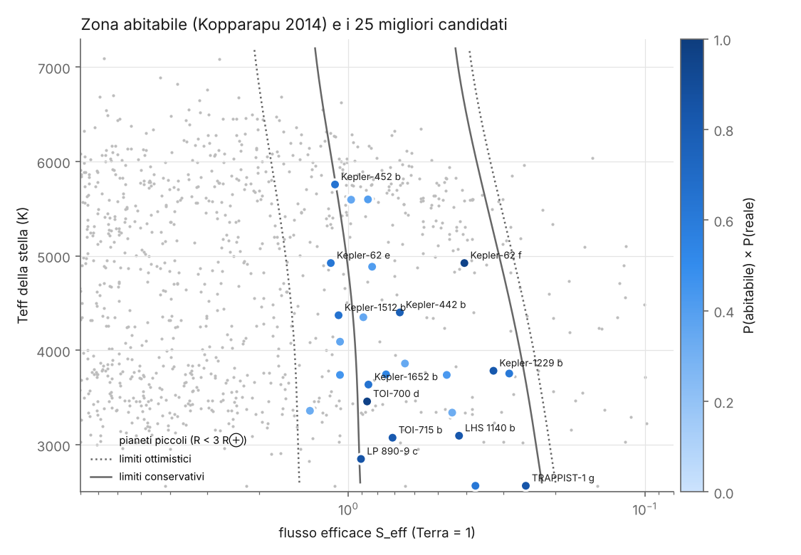
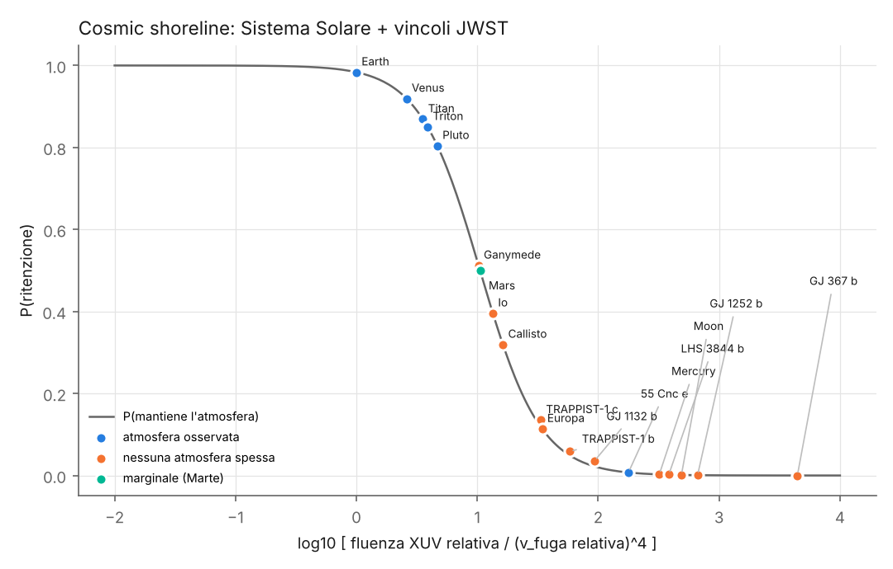
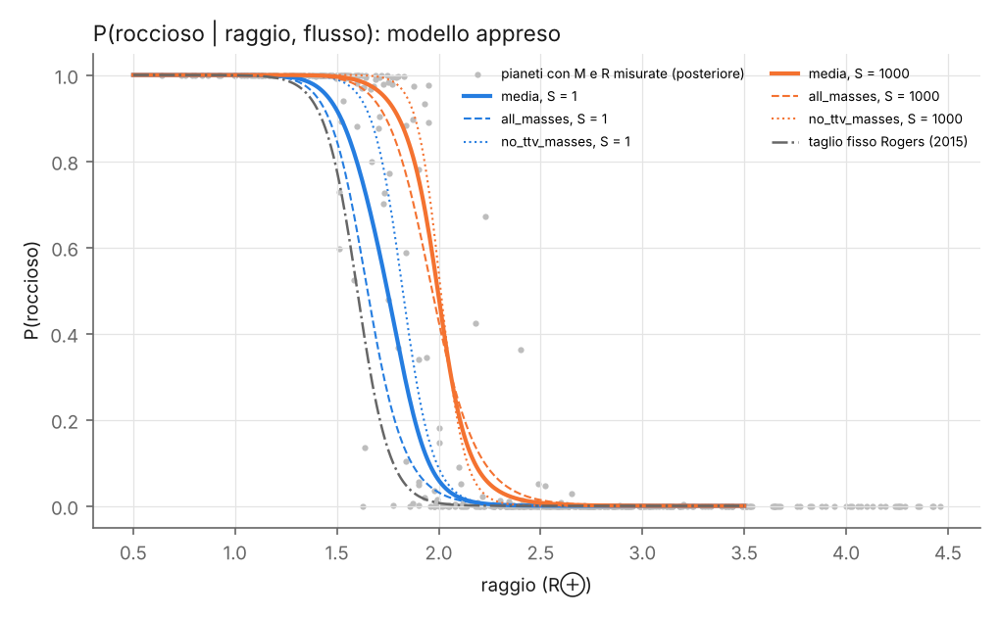
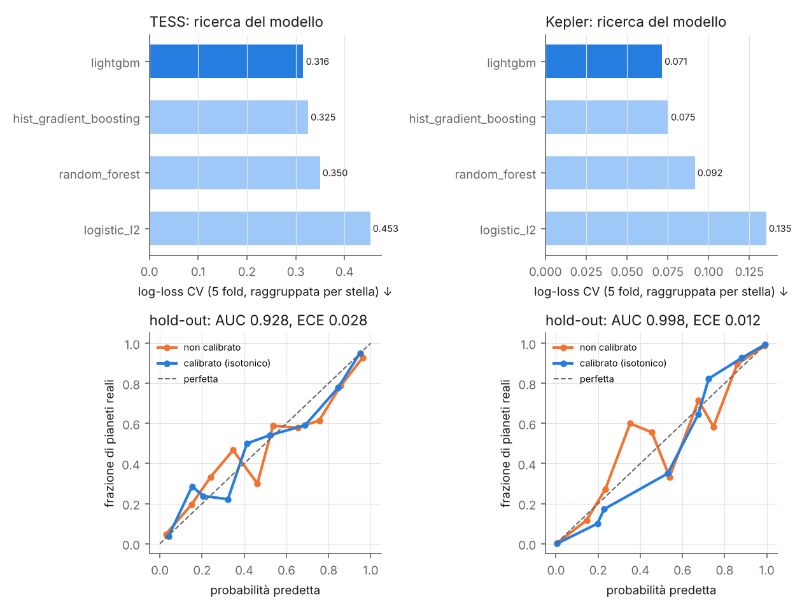

# Ricerca di pianeti potenzialmente abitabili: risultati

Pianeti e candidati analizzati: **13772** (6473 confermati, 7299 candidati TESS/Kepler ancora aperti), di cui 12897 con dati sufficienti. Ogni oggetto è valutato con 2000 campioni Monte Carlo delle incertezze. Tempo di esecuzione: 558.7 s.

Numero atteso di mondi abitabili (somma delle probabilità): **18.3** tra i confermati, **6.1** tra i candidati (già pesato per P(reale)).

**Come leggere P(abitabile).** È la probabilità, date le misure e i loro errori, che il pianeta sia roccioso, stia nella zona abitabile (con incertezza sui bordi), orbiti una stella di sequenza principale e abbia potuto trattenere un'atmosfera. È una condizione *necessaria*, non una prova di vita: nessun pianeta extrasolare è mai stato osservato come abitabile.

## I migliori candidati



| rank | name | source | p_real | p_habitable | p_habitable_and_real | robust_top_fraction | p_rocky | p_hz | p_atm_retention | s_eff_med | radius_med | st_teff | dist_pc | case | hwc_habitable |
|---|---|---|---|---|---|---|---|---|---|---|---|---|---|---|---|
| 1 | TOI-700 d | confirmed | 1.000 | 0.971 | 0.971 | 1.000 | 0.999 | 0.997 | 0.974 | 0.865 | 1.143 | 3459.000 | 31.100 | B | 1.000 |
| 2 | Kepler-62 f | confirmed | 1.000 | 0.961 | 0.961 | 1.000 | 0.962 | 0.999 | 0.999 | 0.406 | 1.408 | 4925.000 | 300.900 | B | 1.000 |
| 3 | LP 890-9 c | confirmed | 1.000 | 0.852 | 0.852 | 1.000 | 0.978 | 1.000 | 0.872 | 0.908 | 1.365 | 2850.000 | 32.400 | B | 1.000 |
| 4 | TRAPPIST-1 g | confirmed | 1.000 | 0.841 | 0.841 | 1.000 | 1.000 | 1.000 | 0.841 | 0.252 | 1.129 | 2566.000 | 12.400 | A | 1.000 |
| 5 | LHS 1140 b | confirmed | 1.000 | 0.830 | 0.830 | 1.000 | 0.834 | 1.000 | 0.995 | 0.424 | 1.729 | 3096.000 | 15.000 | A | 2.000 |
| 6 | Kepler-1229 b | confirmed | 1.000 | 0.826 | 0.826 | 1.000 | 0.950 | 0.872 | 0.999 | 0.324 | 1.401 | 3784.000 | 265.500 | B | 1.000 |
| 7 | TOI-715 b | confirmed | 1.000 | 0.820 | 0.820 | 1.000 | 0.849 | 0.979 | 0.987 | 0.710 | 1.553 | 3075.000 | 42.400 | B | 1.000 |
| 8 | Kepler-442 b | confirmed | 1.000 | 0.777 | 0.777 | 1.000 | 0.972 | 0.805 | 0.992 | 0.671 | 1.343 | 4402.000 | 366.000 | B | 1.000 |
| 9 | Kepler-1512 b | confirmed | 1.000 | 0.655 | 0.655 | 1.000 | 0.998 | 0.664 | 0.983 | 1.080 | 1.179 | 4372.000 | 162.000 | B | 0.000 |
| 10 | Kepler-1652 b | confirmed | 1.000 | 0.651 | 0.651 | 1.000 | 0.718 | 0.913 | 0.996 | 0.857 | 1.597 | 3638.000 | 252.000 | B | 1.000 |
| 11 | Kepler-452 b | confirmed | 1.000 | 0.645 | 0.645 | 1.000 | 0.651 | 0.992 | 1.000 | 1.110 | 1.630 | 5757.000 | 551.700 | B | 2.000 |
| 12 | Kepler-62 e | confirmed | 1.000 | 0.626 | 0.626 | 1.000 | 0.771 | 0.813 | 0.999 | 1.147 | 1.611 | 4925.000 | 300.900 | B | 2.000 |
| 13 | TRAPPIST-1 f | confirmed | 1.000 | 0.619 | 0.619 | 0.889 | 1.000 | 1.000 | 0.619 | 0.373 | 1.045 | 2566.000 | 12.400 | A | 1.000 |
| 14 | Kepler-186 f | confirmed | 1.000 | 0.616 | 0.616 | 1.000 | 0.998 | 0.621 | 0.996 | 0.287 | 1.171 | 3755.000 | 177.600 | B | 1.000 |
| 15 | TOI-2095.03 | toi | 0.969 | 0.555 | 0.538 | 1.000 | 0.824 | 0.985 | 0.736 | 0.747 | 1.188 | 3746.000 | 41.900 | B |  |
| 16 | Kepler-296 e | confirmed | 1.000 | 0.452 | 0.452 | 1.000 | 0.735 | 0.627 | 0.987 | 1.068 | 1.541 | 3740.000 | 167.000 | B | 1.000 |
| 17 | Kepler-296 f | confirmed | 1.000 | 0.429 | 0.429 | 1.000 | 0.454 | 0.950 | 0.999 | 0.466 | 1.784 | 3740.000 | 167.000 | B | 2.000 |
| 18 | Kepler-1544 b | confirmed | 1.000 | 0.410 | 0.410 | 1.000 | 0.414 | 0.990 | 1.000 | 0.832 | 1.779 | 4886.000 | 335.100 | B | 2.000 |
| 19 | TOI-2263.01 | toi | 0.774 | 0.521 | 0.403 | 1.000 | 0.571 | 0.986 | 0.958 | 0.860 | 1.641 | 5599.000 | 99.900 | B |  |
| 20 | Kepler-1410 b | confirmed | 1.000 | 0.360 | 0.360 | 0.667 | 0.451 | 0.795 | 0.999 | 1.068 | 1.779 | 4092.000 | 367.000 | B | 2.000 |
| 21 | Kepler-22 b | confirmed | 1.000 | 0.354 | 0.354 | 0.056 | 0.355 | 1.000 | 1.000 | 0.980 | 2.100 | 5596.000 | 194.600 | B | 2.000 |
| 22 | Kepler-283 c | confirmed | 1.000 | 0.353 | 0.353 | 0.056 | 0.365 | 0.966 | 1.000 | 0.891 | 1.817 | 4351.000 | 468.100 | B | 2.000 |
| 23 | TOI-7390.01 | toi | 0.877 | 0.393 | 0.345 | 0.000 | 0.545 | 0.998 | 0.848 | 0.645 | 1.672 | 3861.000 | 61.800 | B |  |
| 24 | K2-72 e | confirmed | 1.000 | 0.329 | 0.329 | 0.000 | 0.975 | 0.373 | 0.861 | 1.349 | 1.293 | 3360.000 | 66.400 | B | 1.000 |
| 25 | K2-288 B b | confirmed | 1.000 | 0.322 | 0.322 | 0.000 | 0.332 | 0.964 | 1.000 | 0.447 | 1.888 | 3341.000 | 65.600 | B | 2.000 |
| 26 | TOI-2433.01 | toi | 0.754 | 0.420 | 0.317 | 0.000 | 0.468 | 0.991 | 0.956 | 0.383 | 1.825 | 3323.000 | 32.600 | B |  |
| 27 | K07223.01 | koi | 0.457 | 0.667 | 0.304 | 0.000 | 0.671 | 0.993 | 1.000 | 0.562 | 1.586 | 5366.000 |  | B |  |
| 28 | K04427.01 | koi | 0.975 | 0.298 | 0.291 | 0.000 | 0.775 | 0.386 | 1.000 | 0.229 | 1.585 | 3788.000 |  | B |  |
| 29 | Kepler-438 b | confirmed | 1.000 | 0.289 | 0.289 | 0.000 | 0.995 | 0.313 | 0.811 | 1.641 | 1.121 | 3748.000 | 195.900 | B | 0.000 |
| 30 | Proxima Cen b | confirmed | 1.000 | 0.271 | 0.271 | 0.000 | 0.406 | 1.000 | 0.723 | 0.644 | 1.067 | 2900.000 | 1.300 | D | 1.000 |

`robust_top_fraction` è la frazione di varianti del modello (posizione e larghezza della shoreline, prior sulla frazione di nucleo) in cui il pianeta resta nella top 20. `case`: A = massa e raggio misurati, B = solo raggio, C = solo massa, D = solo M sin i. `hwc_habitable`: etichetta PHL (1 conservativo, 2 ottimistico, 0 no, vuoto = non presente nel catalogo PHL).

## Validazione sul Sistema Solare

| name | expected | p_habitable | p_rocky | p_hz | p_atm_retention | s_eff_med | case |
|---|---|---|---|---|---|---|---|
| Mercury | not habitable | 0.000 | 1.000 | 0.000 | 0.003 | 6.821 | A |
| Venus | not habitable | 0.000 | 1.000 | 0.000 | 0.919 | 1.913 | A |
| Earth | habitable | 0.984 | 1.000 | 1.000 | 0.984 | 1.000 | A |
| Mars | marginal | 0.494 | 1.000 | 1.000 | 0.494 | 0.432 | A |
| Jupiter | not habitable | 0.000 | 0.000 | 0.000 | 1.000 | 0.037 | A |
| Saturn | not habitable | 0.000 | 0.000 | 0.000 | 1.000 | 0.011 | A |
| Uranus | not habitable | 0.000 | 0.000 | 0.000 | 1.000 | 0.003 | A |
| Neptune | not habitable | 0.000 | 0.000 | 0.000 | 1.000 | 0.001 | A |
| Earth (transit-only, 3% radius) | habitable | 0.981 | 1.000 | 1.000 | 0.981 | 1.000 | B |
| Earth (RV-only, Msini 10%) | habitable | 0.491 | 0.498 | 1.000 | 0.989 | 1.000 | D |

## Cosmic shoreline (perdita dell'atmosfera)



| body | kind | log10_ratio | p_retention | observed_atmosphere | correct | reference |
|---|---|---|---|---|---|---|
| Mercury | Solar System | 2.505 | 0.003 | False | 1.000 | NASA fact sheets; Zahnle & Catling 2017 |
| Venus | Solar System | 0.415 | 0.919 | True | 1.000 | NASA fact sheets; Zahnle & Catling 2017 |
| Earth | Solar System | 0.000 | 0.984 | True | 1.000 | NASA fact sheets; Zahnle & Catling 2017 |
| Moon | Solar System | 2.688 | 0.001 | False | 1.000 | NASA fact sheets; Zahnle & Catling 2017 |
| Mars | Solar System | 1.023 | 0.500 | None |  | NASA fact sheets; Zahnle & Catling 2017 |
| Io | Solar System | 1.129 | 0.396 | False | 1.000 | NASA fact sheets; Zahnle & Catling 2017 |
| Europa | Solar System | 1.536 | 0.114 | False | 1.000 | NASA fact sheets; Zahnle & Catling 2017 |
| Ganymede | Solar System | 1.011 | 0.512 | False | 0.000 | NASA fact sheets; Zahnle & Catling 2017 |
| Callisto | Solar System | 1.212 | 0.319 | False | 1.000 | NASA fact sheets; Zahnle & Catling 2017 |
| Titan | Solar System | 0.550 | 0.869 | True | 1.000 | NASA fact sheets; Zahnle & Catling 2017 |
| Triton | Solar System | 0.589 | 0.850 | True | 1.000 | NASA fact sheets; Zahnle & Catling 2017 |
| Pluto | Solar System | 0.670 | 0.804 | True | 1.000 | NASA fact sheets; Zahnle & Catling 2017 |
| LHS 3844 b | exoplanet (thermal emission) | 2.584 | 0.002 | False | 1.000 | Kreidberg et al. 2019, Nature 573, 87 (Spitzer: bare rock) |
| GJ 1252 b | exoplanet (thermal emission) | 2.822 | 0.001 | False | 1.000 | Crossfield et al. 2022, ApJL 937, L17 (no thick atmosphere) |
| TRAPPIST-1 b | exoplanet (thermal emission) | 1.765 | 0.059 | False | 1.000 | Greene et al. 2023, Nature 618, 39 (no thick atmosphere) |
| TRAPPIST-1 c | exoplanet (thermal emission) | 1.525 | 0.135 | False | 1.000 | Zieba et al. 2023, Nature 620, 746 (no thick CO2 atmosphere) |
| GJ 1132 b | exoplanet (thermal emission) | 1.968 | 0.035 | False | 1.000 | Xue et al. 2024, ApJL 973, L8 (no thick atmosphere) |
| GJ 367 b | exoplanet (thermal emission) | 3.648 | 0.000 | False | 1.000 | Zhang et al. 2024, ApJL 961, L44 (airless, dark surface) |
| 55 Cnc e | exoplanet (thermal emission) | 2.251 | 0.008 | True | 0.000 | Hu et al. 2024, Nature 630, 609 (secondary atmosphere; magma-ocean outgassing) |

Nota: 55 Cnc e è un mondo a oceano di magma con atmosfera da degassamento continuo. Il modello, che considera solo la fuga atmosferica, lo predice senza atmosfera: questo è un limite noto.

## Modello roccioso appreso (deconvoluzione EM)



P(roccioso) è la media a pesi uguali di due modelli: uno addestrato su tutte le masse misurate e uno senza i sistemi TTV. Le masse TTV tendono a densità basse, quelle RV a densità alte: la media porta questa incertezza sistematica nel risultato invece di scegliere un lato.

**all_masses / variabile radius**: scelto `logistic_size_flux_clamped` (n = 432; componente volatile μ = 0.171 dex, τ = 0.070 dex). Log-verosimiglianza media su fold esclusi (più alta = meglio):

| modello | cv_mean_heldout_loglik | cv_heldout_loglik_low_flux | monotone |
|---|---|---|---|
| rogers2015_fixed | 1.1999 | 1.8482 | True |
| logistic_size | 1.2669 | 1.9778 | True |
| logistic_size_flux | 1.2688 | 1.8558 | True |
| logistic_size_flux_clamped | 1.2719 | 1.8891 | True |
| logistic_size_flux_quadratic | 1.2737 | 1.8660 | False |
| logistic_size_flux_quadratic_clamped | 1.2746 | 1.8884 | False |

**all_masses / variabile mass**: scelto `logistic_size_flux_clamped` (n = 432; componente volatile μ = 0.161 dex, τ = 0.078 dex). Log-verosimiglianza media su fold esclusi (più alta = meglio):

| modello | cv_mean_heldout_loglik | cv_heldout_loglik_low_flux | monotone |
|---|---|---|---|
| rogers2015_fixed | 0.8916 | 1.6921 | True |
| logistic_size | 0.9720 | 1.6852 | True |
| logistic_size_flux | 1.0425 | 1.4074 | True |
| logistic_size_flux_clamped | 1.0497 | 1.6253 | True |
| logistic_size_flux_quadratic | 1.0528 | 1.7177 | False |
| logistic_size_flux_quadratic_clamped | 1.0491 | 1.6993 | False |

**no_ttv_masses / variabile radius**: scelto `logistic_size_flux_quadratic_clamped` (n = 315; componente volatile μ = 0.156 dex, τ = 0.056 dex). Log-verosimiglianza media su fold esclusi (più alta = meglio):

| modello | cv_mean_heldout_loglik | cv_heldout_loglik_low_flux | monotone |
|---|---|---|---|
| rogers2015_fixed | 1.3570 | 1.3501 | True |
| logistic_size | 1.4705 | 1.6502 | True |
| logistic_size_flux | 1.4757 | 1.5050 | True |
| logistic_size_flux_clamped | 1.4779 | 1.5547 | True |
| logistic_size_flux_quadratic | 1.4869 | 1.6365 | False |
| logistic_size_flux_quadratic_clamped | 1.4849 | 1.6005 | True |

**no_ttv_masses / variabile mass**: scelto `logistic_size_flux` (n = 315; componente volatile μ = 0.148 dex, τ = 0.062 dex). Log-verosimiglianza media su fold esclusi (più alta = meglio):

| modello | cv_mean_heldout_loglik | cv_heldout_loglik_low_flux | monotone |
|---|---|---|---|
| rogers2015_fixed | 1.0861 | 1.1956 | True |
| logistic_size | 1.1535 | 1.1800 | True |
| logistic_size_flux | 1.2628 | 1.1578 | True |
| logistic_size_flux_clamped | 1.2616 | 1.1787 | True |
| logistic_size_flux_quadratic | 1.2645 | 1.1235 | False |
| logistic_size_flux_quadratic_clamped | 1.2667 | 1.1558 | False |

## Vetting dei candidati (ML con etichette reali)



**TESS**: 2851 candidati risolti. Modello scelto: `lightgbm (learning_rate=0.03, num_leaves=15, n_estimators=400)`. Hold-out (stelle mai viste): AUC 0.928, AP 0.910, log-loss 0.340 (non calibrato 0.346), Brier 0.106, ECE 0.028.

| family | config | cv_log_loss | cv_roc_auc | cv_brier | selected |
|---|---|---|---|---|---|
| lightgbm | learning_rate=0.03, num_leaves=15, n_estimators=400 | 0.3155 | 0.9390 | 0.0940 | True |
| hist_gradient_boosting | min_samples_leaf=20, max_features=1.0, learning_rate=0.03, max_leaf_nodes=15 | 0.3252 | 0.9338 | 0.0986 | False |
| hist_gradient_boosting | min_samples_leaf=20, max_features=1.0, learning_rate=0.03, max_leaf_nodes=31 | 0.3300 | 0.9327 | 0.0994 | False |
| hist_gradient_boosting | min_samples_leaf=20, max_features=1.0, learning_rate=0.1, max_leaf_nodes=31 | 0.3335 | 0.9348 | 0.0993 | False |
| hist_gradient_boosting | min_samples_leaf=20, max_features=1.0, learning_rate=0.1, max_leaf_nodes=15 | 0.3344 | 0.9324 | 0.1003 | False |
| lightgbm | learning_rate=0.02, num_leaves=31, n_estimators=800 | 0.3386 | 0.9409 | 0.0948 | False |
| lightgbm | learning_rate=0.05, num_leaves=31, n_estimators=300 | 0.3419 | 0.9393 | 0.0962 | False |
| random_forest | min_samples_leaf=1, max_features=sqrt, max_leaf_nodes=None, n_estimators=400 | 0.3496 | 0.9311 | 0.1061 | False |

Feature più importanti (aumento della log-loss permutandole):

| feature | delta_log_loss | std |
|---|---|---|
| log_radius | 0.0866 | 0.0150 |
| log_duration_ratio | 0.0717 | 0.0119 |
| eqt | 0.0438 | 0.0179 |
| teff | 0.0340 | 0.0081 |
| log_period | 0.0299 | 0.0065 |
| log_depth_ppm | 0.0255 | 0.0082 |
| log_period_rel_err | 0.0236 | 0.0077 |
| radius_rel_err | 0.0182 | 0.0095 |
| depth_snr | 0.0171 | 0.0070 |
| log_dist | 0.0088 | 0.0030 |

**Kepler**: 7587 candidati risolti. Modello scelto: `lightgbm (learning_rate=0.03, num_leaves=15, n_estimators=400)`. Hold-out (stelle mai viste): AUC 0.998, AP 0.996, log-loss 0.058 (non calibrato 0.057), Brier 0.016, ECE 0.012.

| family | config | cv_log_loss | cv_roc_auc | cv_brier | selected |
|---|---|---|---|---|---|
| lightgbm | learning_rate=0.03, num_leaves=15, n_estimators=400 | 0.0714 | 0.9964 | 0.0193 | True |
| lightgbm | learning_rate=0.02, num_leaves=31, n_estimators=800 | 0.0752 | 0.9966 | 0.0190 | False |
| lightgbm | learning_rate=0.05, num_leaves=31, n_estimators=300 | 0.0752 | 0.9965 | 0.0191 | False |
| hist_gradient_boosting | min_samples_leaf=20, max_features=1.0, learning_rate=0.03, max_leaf_nodes=15 | 0.0753 | 0.9958 | 0.0205 | False |
| hist_gradient_boosting | min_samples_leaf=20, max_features=1.0, learning_rate=0.1, max_leaf_nodes=15 | 0.0763 | 0.9957 | 0.0202 | False |
| hist_gradient_boosting | min_samples_leaf=20, max_features=1.0, learning_rate=0.03, max_leaf_nodes=31 | 0.0765 | 0.9958 | 0.0208 | False |
| lightgbm | learning_rate=0.03, num_leaves=63, n_estimators=600 | 0.0781 | 0.9965 | 0.0193 | False |
| hist_gradient_boosting | min_samples_leaf=20, max_features=1.0, learning_rate=0.1, max_leaf_nodes=31 | 0.0792 | 0.9958 | 0.0208 | False |

Feature più importanti (aumento della log-loss permutandole):

| feature | delta_log_loss | std |
|---|---|---|
| log_prad | 0.0975 | 0.0089 |
| log_max_mult_ev | 0.0610 | 0.0042 |
| log_duration_ratio | 0.0439 | 0.0057 |
| fwm_offset_src | 0.0245 | 0.0055 |
| n_candidates_system | 0.0211 | 0.0026 |
| dikco_msky_sig | 0.0198 | 0.0039 |
| dicco_msky_sig | 0.0166 | 0.0032 |
| log_ror | 0.0121 | 0.0019 |
| log_model_snr | 0.0084 | 0.0006 |
| log_dor | 0.0074 | 0.0029 |

## Confronto tra modelli di abitabilità (ablazioni)

Non esiste un insieme etichettato di pianeti abitabili, quindi il modello migliore non si sceglie con l'accuratezza sulle etichette di un catalogo. Si sceglie con i test fisici (Sistema Solare, JWST) e con la corretta propagazione delle incertezze. L'accordo con il PHL è riportato solo come riferimento.

| model | solar_earth | solar_mars | solar_max_not_habitable | solar_earth_rv_only | n_p_gt_0.5 | expected_n_habitable | top25_overlap_with_full | spearman_vs_full | auc_vs_hwc_any |
|---|---|---|---|---|---|---|---|---|---|
| full_physical_mc | 0.984 | 0.494 | 0.000 | 0.491 | 14 | 18.330 | 1.000 | 1.000 | 0.998 |
| no_atmosphere_term | 1.000 | 1.000 | 0.000 | 0.498 | 16 | 21.447 | 0.880 | 0.943 | 0.998 |
| no_uncertainty (point estimates) | 0.984 | 0.494 | 0.000 | 0.704 | 15 | 18.157 | 0.840 | 0.682 | 0.970 |
| fixed_rogers_rocky_cut | 0.983 | 0.494 | 0.000 | 0.936 | 17 | 21.048 | 0.720 | 0.755 | 0.997 |
| rocky_all_masses_only | 0.984 | 0.494 | 0.000 | 0.532 | 13 | 17.014 | 0.840 | 0.964 | 0.998 |
| rocky_no_ttv_masses_only | 0.984 | 0.494 | 0.000 | 0.450 | 19 | 19.632 | 0.920 | 0.962 | 0.997 |
| binary_conservative_hz | 0.984 | 0.494 | 0.000 | 0.491 | 12 | 15.018 | 0.880 | 0.867 | 0.924 |
| binary_optimistic_hz | 0.984 | 0.494 | 0.000 | 0.491 | 19 | 22.119 | 0.880 | 0.941 | 0.997 |
| hwc_rule_baseline | 1.000 | 1.000 | 0.000 |  | 20 |  | 0.520 | 0.383 | 0.978 |
| esi_only | 1.000 | 0.646 | 0.778 |  | 358 |  | 0.400 | 0.432 | 0.993 |

## Perché non addestriamo un classificatore sulle etichette del catalogo PHL

Un albero decisionale di profondità 2 su 4 colonne del catalogo stesso ottiene AUC 0.984 in cross-validation, e di profondità 4 ottiene 0.985 (70 positivi su 5358). Le etichette sono una regola deterministica (zona abitabile + limiti di raggio/massa): un modello di ML addestrato su di esse riscopre la regola e non aggiunge informazione fisica.

```
|--- P_FLUX <= 1.64
|   |--- P_RADIUS <= 3.07
|   |   |--- P_FLUX <= 0.24
|   |   |   |--- class: 0
|   |   |--- P_FLUX >  0.24
|   |   |   |--- P_FLUX <= 1.51
|   |   |   |   |--- class: 1
|   |   |   |--- P_FLUX >  1.51
|   |   |   |   |--- class: 1
|   |--- P_RADIUS >  3.07
|   |   |--- P_FLUX <= 0.00
|   |   |   |--- class: 0
|   |   |--- P_FLUX >  0.00
|   |   |   |--- class: 0
|--- P_FLUX >  1.64
|   |--- P_FLUX <= 1.65
|   |   |--- class: 0
|   |--- P_FLUX >  1.65
|   |   |--- class: 0

```

Accordo del modello completo con il PHL (solo come riferimento): AUC 0.998 su 5284 pianeti in comune.

### Pianeti abitabili per il PHL ma scartati dal modello, con il motivo

| name | hwc_habitable | p_habitable | p_rocky | p_hz | p_atm_retention | p_main_sequence | radius_med | s_eff_med | case |
|---|---|---|---|---|---|---|---|---|---|
| GJ 180 c | 2.000 | 0.039 | 0.055 | 0.893 | 0.986 | 1.000 | 1.753 | 0.830 | D |
| GJ 682 b | 2.000 | 0.036 | 0.048 | 0.845 | 0.991 | 1.000 | 1.615 | 0.301 | D |
| Kepler-705 b | 2.000 | 0.025 | 0.025 | 0.999 | 1.000 | 1.000 | 2.106 | 0.764 | B |
| TOI-904 c | 2.000 | 0.020 | 0.021 | 0.953 | 1.000 | 1.000 | 2.169 | 0.553 | B |
| Kepler-174 d | 2.000 | 0.020 | 0.020 | 1.000 | 1.000 | 1.000 | 2.188 | 0.586 | B |
| GJ 667 C c | 2.000 | 0.019 | 0.023 | 0.898 | 0.993 | 1.000 | 1.529 | 0.878 | D |
| Ross 128 b | 1.000 | 0.019 | 0.298 | 0.119 | 0.631 | 1.000 | 1.162 | 1.489 | D |
| Kepler-1606 b | 2.000 | 0.014 | 0.066 | 0.227 | 1.000 | 1.000 | 2.069 | 1.644 | B |
| TOI-2257 b | 2.000 | 0.013 | 0.014 | 0.911 | 1.000 | 1.000 | 2.194 | 0.768 | B |
| TRAPPIST-1 d | 1.000 | 0.013 | 1.000 | 0.525 | 0.024 | 1.000 | 0.788 | 1.116 | A |
| Kepler-443 b | 2.000 | 0.012 | 0.015 | 0.813 | 1.000 | 1.000 | 2.336 | 0.865 | B |
| K2-332 b | 2.000 | 0.012 | 0.020 | 0.558 | 0.999 | 1.000 | 2.207 | 1.187 | B |
| Kepler-1701 b | 2.000 | 0.011 | 0.022 | 0.514 | 1.000 | 1.000 | 2.228 | 1.354 | B |
| GJ 273 b | 1.000 | 0.011 | 0.028 | 0.456 | 0.966 | 1.000 | 1.399 | 1.064 | D |
| GJ 1061 c | 1.000 | 0.010 | 0.241 | 0.092 | 0.440 | 1.000 | 1.183 | 1.453 | C |
| Kepler-155 c | 2.000 | 0.008 | 0.013 | 0.617 | 1.000 | 1.000 | 2.240 | 1.014 | B |
| Wolf 1061 c | 2.000 | 0.006 | 0.017 | 0.452 | 0.972 | 1.000 | 1.468 | 1.223 | D |
| GJ 433 d | 2.000 | 0.004 | 0.004 | 1.000 | 0.999 | 1.000 | 1.657 | 0.641 | D |
| HD 40307 g | 2.000 | 0.003 | 0.004 | 0.958 | 1.000 | 1.000 | 1.820 | 0.700 | D |
| HN Lib b | 2.000 | 0.003 | 0.003 | 1.000 | 0.999 | 1.000 | 1.668 | 0.507 | D |
| Ross 508 b | 2.000 | 0.002 | 0.009 | 0.270 | 0.958 | 1.000 | 1.540 | 1.321 | D |
| GJ 514 b | 2.000 | 0.002 | 0.003 | 0.717 | 1.000 | 1.000 | 1.657 | 0.275 | D |
| GJ 357 d | 2.000 | 0.002 | 0.002 | 1.000 | 1.000 | 1.000 | 1.727 | 0.383 | D |
| GJ 367 d | 2.000 | 0.001 | 0.002 | 0.628 | 0.999 | 1.000 | 1.712 | 1.159 | D |
| Kepler-1540 b | 2.000 | 0.001 | 0.001 | 0.995 | 1.000 | 1.000 | 2.494 | 0.774 | B |
| GJ 3293 d | 2.000 | 0.001 | 0.001 | 0.993 | 1.000 | 1.000 | 1.830 | 0.596 | D |
| GJ 163 c | 2.000 | 0.001 | 0.001 | 0.432 | 0.998 | 1.000 | 1.780 | 1.256 | D |
| HD 216520 c | 2.000 | 0.000 | 0.000 | 0.624 | 1.000 | 1.000 | 1.949 | 1.279 | D |
| HIP 38594 b | 2.000 | 0.000 | 0.001 | 0.309 | 1.000 | 1.000 | 1.871 | 1.348 | D |
| GJ 229 A c | 2.000 | 0.000 | 0.000 | 0.172 | 1.000 | 1.000 | 1.879 | 0.204 | D |
| K2-18 b | 2.000 | 0.000 | 0.000 | 0.407 | 0.993 | 1.000 | 2.376 | 1.268 | A |
| GJ 180 d | 2.000 | 0.000 | 0.001 | 0.000 | 1.000 | 1.000 | 1.825 | 0.137 | D |

## Dati

- `hwc`: 5599 righe, scaricato 2026-11-27T22:09:07+00:00 da https://www.hpcf.upr.edu/~abel/phl/hwc/data/hwc.csv
- `koi`: 9564 righe, scaricato 2026-11-27T22:09:06+00:00 da https://exoplanetarchive.ipac.caltech.edu/TAP/sync
- `pscomppars`: 6473 righe, scaricato 2026-11-27T22:28:53+00:00 da https://exoplanetarchive.ipac.caltech.edu/TAP/sync
- `toi`: 8175 righe, scaricato 2026-11-27T22:09:02+00:00 da https://exoplanetarchive.ipac.caltech.edu/TAP/sync
