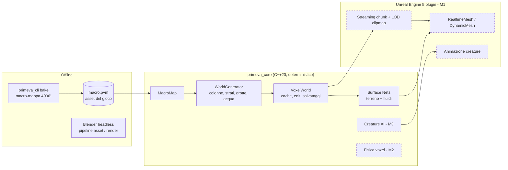
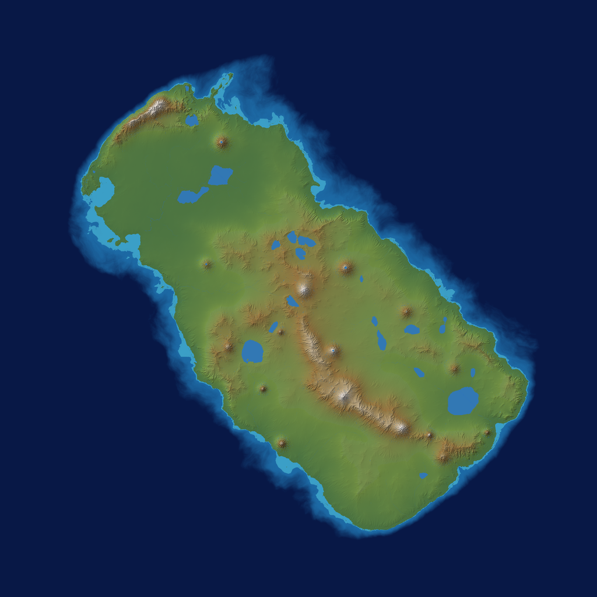
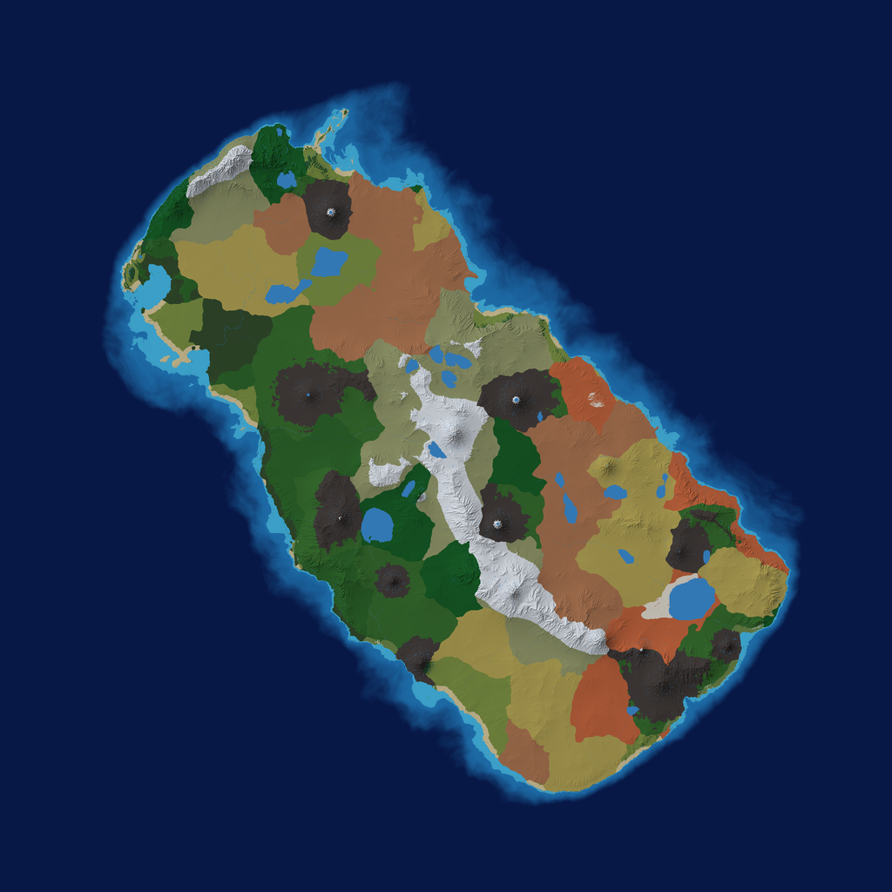
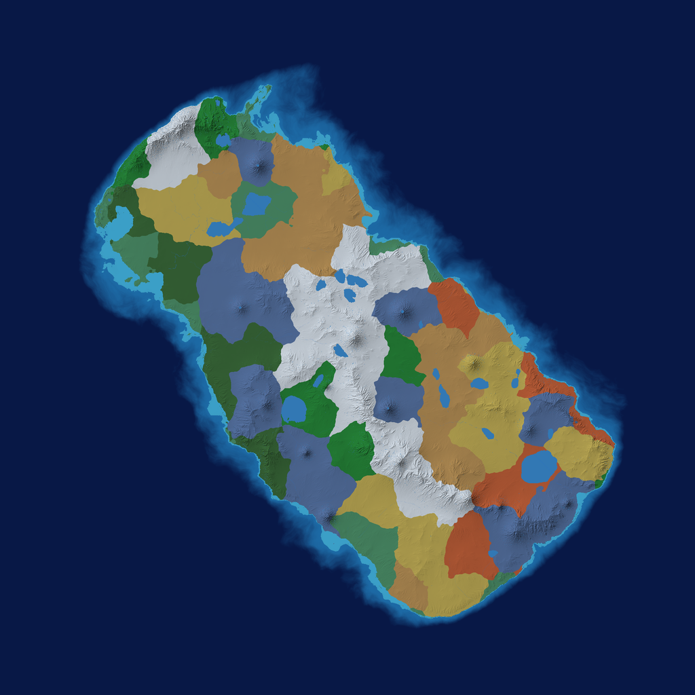
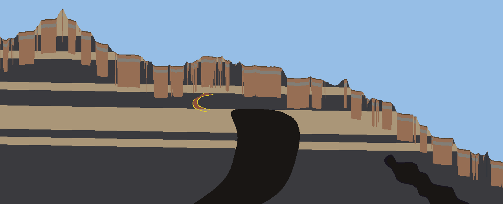
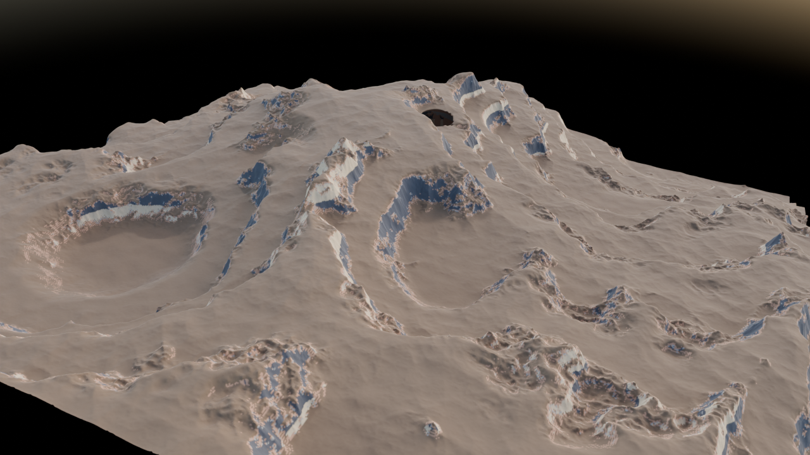

# Primeva: architettura e piano (documento master)

> **📍 DOVE SIAMO (aggiornato al 28/11/2026)**
> - ✅ **M0 completato.** Il core del mondo voxel in C++ è compilato, ha 13 test verdi ed è misurato: mondo grande come l'Italia, voxel da 12,5 cm, scavo che conserva la massa, grotte, fiumi, ere.
> - ✅ **Design.** Ci sono 4 documenti di ricerca e progettazione e un roster di **90 specie** con JSON validato.
> - ⏭️ **Prossimo passo: M1**, cioè il plugin Unreal che mostra in tempo reale il mondo generato dal core, più il LOD.
> - ❓ **Decisioni che spettano a te:** sezione 6, in fondo.

---

## 1. Dove il brief originale andava corretto (e perché)

| Richiesta | Problema (primi principi) | Cosa facciamo |
|---|---|---|
| Mappa grande come l'Italia (~301.000 km²) | Lo *storage* non è un problema: il terreno è una funzione deterministica del seed e salviamo solo le modifiche. I problemi sono il **contenuto** e la **densità di gioco**. È 2.000-6.000 volte un'isola di ARK: 100 ore a piedi da costa a costa, e mondo vuoto (il "problema Daggerfall"). | Il **mondo intero esiste** (la bake macro ha 301.340 km² esatti). Il gioco però si sviluppa in **8 nuclei densi** da 150-500 km², con fasce selvagge rade tra l'uno e l'altro (vedi `design/04_world_biomes.md`). Si comincia con un vertical slice di 4×4 km. |
| Particelle "piccolissime", quasi realistiche | Un voxel cubico piccolo resta un cubo: il realismo viene dalla *forma*, non dalla dimensione. | Voxel da **12,5 cm con SDF** (signed distance) e mesh liscia Surface Nets. Il risultato visivo è vicino a quello di Enshrouded e Teardown, con scavo ovunque. |
| "Fisica elevata" ovunque | Simulare la fisica su 301.000 km² è impossibile su qualunque hardware. | La fisica gira solo in "bolle" attorno ai giocatori (64-200 m). Altrove lo stato è congelato o simulato in modo statistico. |
| Creature che "imparano" | Reti neurali o RL online per creatura non sono deterministici, non si leggono, costano troppo, e su un server multiplayer si rompono. | Libreria di **Tecniche parametrizzate** + Utility AI + bandit contestuale + trasmissione sociale a stadi (vedi `research/02_creature_ai.md`). L'apprendimento è nei *dati*, è deterministico e si spiega al giocatore ("perché l'ha fatto?"). |
| Unreal Engine + Blender | In questo ambiente cloud non c'è GPU e l'accesso a Epic è bloccato, quindi **Unreal qui non gira**. | Il cuore è un **core C++ indipendente dal motore**, che serve anche al server dedicato. Unreal diventa un plugin sottile sopra il core (M1, sulla tua macchina). Blender invece gira già qui, headless, per pipeline e render. |
| "Almeno 70 creature" | Va bene, ma 70 specie con IA, animazioni e modelli sono il costo dominante del progetto. | Roster di **90 specie** già disegnato. La produzione va per tier: il vertical slice ne usa 8-12. |
| Simile ad ARK | Genere e meccaniche simili vanno bene. Nomi, creature, lore e meccaniche di taming specifiche di ARK no. | Tutto è originale. I taxa reali compaiono solo come "ispirazione". |

## 2. Architettura

**Principio chiave: il server è autoritativo e il client rigenera.** I chunk non modificati non viaggiano mai in rete: il client li rigenera dal seed. Per questo il generatore deve essere **bit-identico** su ogni piattaforma, e il determinismo è garantito così:
- `dmath`: sin, cos, exp, log, pow e atan scritti da noi usando solo operazioni IEEE esatte;
- compilazione con `-ffp-contract=off` e senza fast-math;
- test di determinismo nel suite.

### Sistema di coordinate
- Primeva: destrorso, +Y in alto, +X est, +Z sud, in metri (come glTF).
- Unreal: `UE(X, Y, Z) = (x, z, y) * 100` cm.
- Le coordinate voxel sono `int32`. Il mondo intero misura 8,4·10⁶ voxel di lato, ben dentro il range.

## 3. Cosa esiste e cosa è stato misurato (M0)

| Componente | Stato | Numeri misurati (4 core, senza GPU) |
|---|---|---|
| Bake macro (4096², celle da 256 m) | ✅ | **36 s** per l'intero continente. Superficie emersa **301.340 km² esatti**. Ere tutte ≥ 7% della superficie. Rete fluviale ~7.200 km. 18 vulcani. |
| Erosione idraulica + termica | ✅ | Droplet model. Le gocce che arrivano in mare depositano il sedimento (si formano delta). |
| Laghi e drenaggio | ✅ | Priority-Flood (Barnes 2014). La portata dei fiumi è in m³/s, la geometria idraulica segue Leopold & Maddock. |
| Clima | ✅ | Latitudine + gradiente termico verticale (6,5 °C/km) + venti occidentali con pioggia orografica e **ombra pluviometrica**. |
| Generatore runtime | ✅ | **3,7 ms per chunk** su un core, **~1.090 chunk/s** su 4 thread. Il fabbisogno stimato a piedi è ~400/s. |
| Geologia | ✅ | Suoli per bioma che si assottigliano con la pendenza, strati piegati e inclinati, filoni di carbone, corpi minerari localizzati, basamento granitico con aureola di marmo, bedrock a -2.000 m. |
| Grotte | ✅ | 7 sistemi: spaghetti, caverne cheese, doline e pozzi carsici, tubi di lava, geodi di cristallo, camere magmatiche, fiumi sotterranei lungo la falda. |
| Acqua | ✅ | Mare, laghi, fiumi e acquiferi in grotta. Le rive sono continue: niente "muri d'acqua". |
| Chunk e codec | ✅ | 54 KiB per chunk in RAM in media, **12,9 KiB codificati**. I chunk uniformi sono gratuiti. |
| Editing | ✅ | Scavo, riempimento e pittura con sfere, box e capsule. La durezza degli attrezzi (o delle creature) è rispettata. **Conservazione esatta della massa**: nessun exploit con cicli scava-e-riempi. |
| Persistenza | ✅ | Region file da 16³ chunk con scrittura atomica (tmp + rename). |
| Mesher | ✅ | Surface Nets senza giunture tra chunk e chiuso (testato). Mesh separata per i fluidi. |
| Export e render | ✅ | GLB, render Blender Cycles, mappe PNG, sezioni geologiche. |

Bug reali trovati dai test e corretti in M0 (ognuno ora ha il suo test):
1. Contabilità delle risorse nello scavo sbagliata del ~2,7%: era un potenziale exploit di duplicazione.
2. Il blending delle lunghezze d'onda del noise tra biomi creava salti di 10-15 m: la superficie risultava ×21 e c'erano 47 M di triangoli in 128 m.
3. L'attenuazione del rilievo vicino all'acqua scattava di colpo: gradino di 7 m.
4. "Muri d'acqua" sui bordi dei laghi.

### Immagini di verifica (generate dal core)
| Rilievo (301.340 km²) | Biomi | Ere |
|---|---|---|
|  |  |  |

| Sezione geologica (strati, grotte, vena di minerale) | Render Blender Cycles (badlands, voxel da 0,125 m, tunnel scavato) |
|---|---|
|  |  |

*Il render serve a verificare la pipeline: colori piatti per materiale e cielo da sistemare. L'aspetto finale verrà dai materiali UE5 di M1.*

## 4. Roadmap

| Milestone | Contenuto | Dove si fa |
|---|---|---|
| **M1. Viewer UE5** | Plugin `PrimevaWorld` che include `primeva_core` come ThirdParty, streaming asincrono dei chunk, RealtimeMeshComponent, LOD a clipmap (8 livelli, 0,125-16 m), far-field a heightfield fino a ~100 km, materiale triplanare per materiale voxel, collisione. | La tua macchina con UE 5.4+ (serve GPU) |
| **M2. Fisica voxel** | Componenti connesse e crolli (distanza massima di supporto per materiale), granulari con angolo di riposo (sabbia, ghiaia, cenere), automa cellulare per acqua e lava negli scavi, frammenti rigidi su Chaos. | Il core, qui |
| **M3. IA creature** | Percezione → memoria → bisogni → Utility AI su Tecniche → HTN di gruppo. Apprendimento con mastery e bandit, trasmissione sociale, LOD dell'IA (2.000 creature attive + 200.000 dormienti). | Il core, qui |
| **M4. Rete** | Server dedicato, replica delta dei voxel, bolle di simulazione, golden-replay di determinismo in CI. | Core + UE |
| **M5. Vertical slice "Il Bivio del Fiume"** | 4×4 km, 3 biomi, fiume, carsismo, tubo di lava, geode, 8-12 specie. | Tutto |
| **M6. Produzione** | Pipeline creature con Blender (rig e LOD), nuclei 1-8. | Team |

## 5. Indice dei documenti
- `research/01_voxel_tech.md`: stato dell'arte voxel, calcoli di scala, fisica, integrazione con Unreal e rete. ⚠️ *Le fonti sono citate a memoria dall'agente e vanno verificate.*
- `research/02_creature_ai.md`: architettura dell'IA e dell'apprendimento, con 41 tecniche d'esempio. ⚠️ *Citazioni e costi in µs sono ipotesi da verificare e misurare.*
- `design/03_creature_roster.md` + `data/creatures/creatures.json`: 90 specie (validatore in `tools/validate_creatures.py`).
- `design/04_world_biomes.md` + `data/world/biomes.json`: mondo, lore originale, 25 biomi e sottosuolo.

## 6. Decisioni che spettano a te
1. **Scala giocabile.** Confermi "mondo intero simulato + 8 nuclei densi", oppure vuoi davvero tutto il territorio con la stessa densità? Quest'ultima strada ha bisogno di un team grande e di molto contenuto procedurale in più.
2. **Unreal.** Hai una macchina con UE 5.4 o superiore e una GPU? Si può collegare a questa sessione per M1. In alternativa M1 si fa con un viewer nativo (Vulkan) sul core.
3. **Plugin voxel commerciale.** Voxel Plugin 2.0 si può usare solo per prototipi (la licenza va verificata). La raccomandazione è restare sul nostro core.
