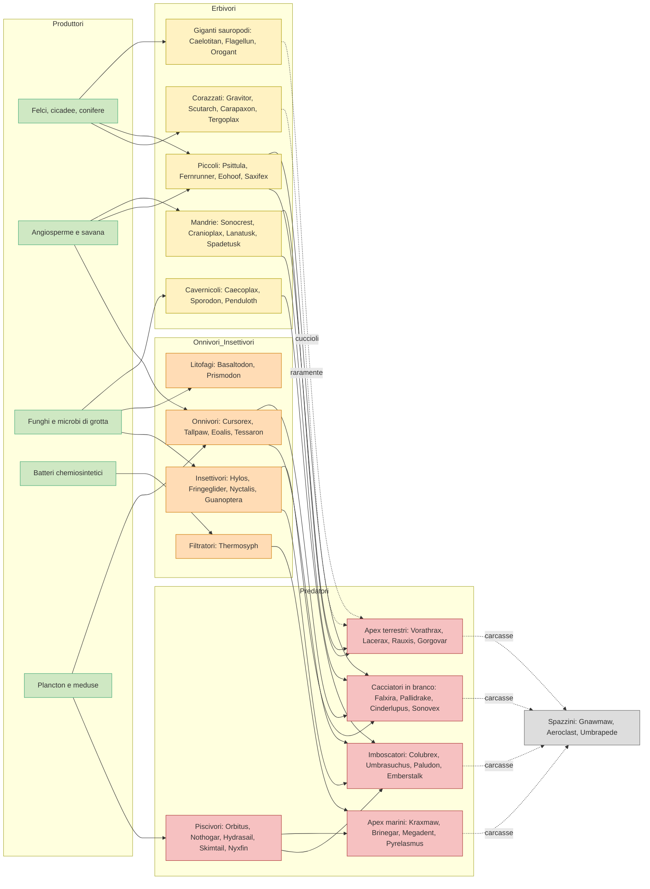

# Primeva — Roster delle creature (v1)

> Documento di design in italiano. Dati sorgente: `primeva/data/creatures/creatures.json` (90 specie). Validazione: `python3 primeva/tools/validate_creatures.py`.

Tutte le specie sono **originali**: nomi, design, meccaniche di addomesticamento e lore sono inventati per Primeva. I taxa reali compaiono solo nel campo `inspiration` dei dati e come ispirazione scientifica.

## 1. Pilastri di design

- **Paleontologia come ispirazione, non come copia.** Ogni creatura parte da un animale reale (dinosauri, pterosauri, rettili marini, sinapsidi permiani, artropodi giganti, megafauna cenozoica) ma ne reinventa nome, proporzioni e tratti di gioco. Le specie sotterranee sono discendenti ipotetici adattati alle grotte (anchilosauri ciechi, troodontidi ecolocalizzanti, ittiosauri cavernicoli).
- **Comportamento agentico.** Ogni specie ha routine, territorio e relazioni con le altre (campo `wild_behavior`) guidate da sensi e istinti, non da script fissi: la fauna selvatica vive anche se il giocatore non c'è.
- **Gli istinti sono la fisica del carattere.** Sette assi (aggressività, paura, curiosità, territorialità, socialità, pazienza, giocosità) determinano come la creatura reagisce, quanto è addomesticabile e quali tecniche impara con facilità.
- **Addomesticamento come relazione, non come tranquillante.** Sette metodi (fiducia, imprinting dall'uovo, dominanza, alimentazione passiva, legame di salvataggio, corteggiamento mimetico, simbiosi) con meccaniche descritte per specie; nessun metodo è un semplice «stordisci e nutri».
- **Strati verticali del mondo.** Superficie, sottosuolo, acqua, aria e anfibio: ogni strato offre ruoli e minacce diversi. Il sottosuolo ha quattro sensi dominanti non visivi (tremore, termico, ecolocalizzazione, olfatto).
- **Progressione in 5 tier**, dalle piccole creature compagne (T1) ai giganti che fungono da basi mobili o da predatori di vertice (T5).
- **Rete trofica equilibrata**: ~40% erbivori, ~30% carnivori (con piscivori ~40%), il resto onnivori, insettivori, spazzini, filtratori e litofagi.

## 2. Riepilogo numerico

| Era | Specie | | Strato | Specie | | Dieta | Specie |
|---|---:|---|---|---:|---|---|---:|
| Carbonifero | 6 | | Superficie | 50 | | erbivoro | 36 |
| Permiano | 8 | | Sottosuolo | 17 | | carnivoro | 27 |
| Triassico | 12 | | Acquatico | 8 | | piscivoro | 10 |
| Giurassico | 14 | | Aereo | 10 | | insettivoro | 6 |
| Cretaceo | 22 | | Anfibio | 5 | | onnivoro | 5 |
| Paleogene | 8 | |  |  | | spazzino | 3 |
| Neogene | 11 | |  |  | | litofago | 2 |
| Pleistocene | 9 | |  |  | | filtratore | 1 |

Tier: T1=20, T2=26, T3=20, T4=14, T5=10. Massa: da 0.05 kg a 70,000 kg.

## 3. Tabella per era

| Era | Specie (tier) |
|---|---|
| Carbonifero | Velaryx (T1), Chilodrax (T2), Paludon (T4), Hylos (T1), Scorpex (T2), Umbrapede (T1) |
| Permiano | Cremaspis (T2), Spinavela (T1), Gorgovar (T4), Scutarch (T2), Burrowtusk (T1), Bulwarkhorn (T3), Pterygar (T3), Sporodon (T1) |
| Triassico | Pallidrake (T1), Prosaurex (T2), Rauxis (T4), Placeron (T2), Nothogar (T2), Stenocollis (T3), Thalassarch (T5), Dartwing (T1), Burrowfur (T1), Fringeglider (T1), Rhynchon (T2), Prismodon (T1) |
| Giurassico | Caelotitan (T5), Tergoplax (T3), Lacerax (T4), Pipsnatch (T1), Eoalis (T1), Skimtail (T2), Orbitus (T3), Kraxmaw (T5), Fernrunner (T2), Flagellun (T4), Scelida (T1), Opalnaut (T2), Nyxfin (T3), Pyrelasmus (T5) |
| Cretaceo | Vorathrax (T5), Cranioplax (T3), Falxira (T2), Gravitor (T4), Sonocrest (T2), Hydrasail (T4), Cirrothrone (T5), Thermalwing (T3), Brinegar (T5), Tessaron (T2), Cursorex (T1), Tholoram (T2), Orogant (T5), Psittula (T2), Tetraptera (T2), Falcarm (T3), Sonovex (T2), Caecoplax (T3), Emberstalk (T4), Basaltodon (T3), Glimmerwing (T2), Umbrasuchus (T4) |
| Paleogene | Clavirostra (T3), Anguicet (T4), Colubrex (T4), Eohoof (T1), Nyctalis (T1), Altimont (T5), Brontoplax (T3), Dinoceron (T3) |
| Neogene | Megadent (T5), Terragrade (T3), Spadetusk (T3), Carapaxon (T2), Aeroclast (T3), Branchhorn (T2), Digdrome (T3), Pallidolm (T1), Guanoptera (T1), Thermosyph (T2), Scoriaclaw (T3) |
| Pleistocene | Lanatusk (T3), Monoceron (T4), Falcidens (T4), Cinderlupus (T2), Tallpaw (T4), Gnawmaw (T2), Coronag (T2), Saxifex (T1), Penduloth (T2) |

## 4. Tabella per strato

| Strato | Specie (tier) |
|---|---|
| Superficie | Chilodrax (T2), Hylos (T1), Scorpex (T2), Cremaspis (T2), Spinavela (T1), Gorgovar (T4), Scutarch (T2), Burrowtusk (T1), Bulwarkhorn (T3), Pallidrake (T1), Prosaurex (T2), Rauxis (T4), Placeron (T2), Burrowfur (T1), Rhynchon (T2), Caelotitan (T5), Tergoplax (T3), Lacerax (T4), Pipsnatch (T1), Fernrunner (T2), Flagellun (T4), Scelida (T1), Vorathrax (T5), Cranioplax (T3), Falxira (T2), Gravitor (T4), Sonocrest (T2), Cursorex (T1), Tholoram (T2), Orogant (T5), Psittula (T2), Falcarm (T3), Clavirostra (T3), Eohoof (T1), Altimont (T5), Brontoplax (T3), Dinoceron (T3), Terragrade (T3), Spadetusk (T3), Carapaxon (T2), Branchhorn (T2), Digdrome (T3), Lanatusk (T3), Monoceron (T4), Falcidens (T4), Cinderlupus (T2), Tallpaw (T4), Gnawmaw (T2), Coronag (T2), Saxifex (T1) |
| Sottosuolo | Sonovex (T2), Caecoplax (T3), Pallidolm (T1), Guanoptera (T1), Emberstalk (T4), Basaltodon (T3), Umbrapede (T1), Prismodon (T1), Glimmerwing (T2), Opalnaut (T2), Nyxfin (T3), Umbrasuchus (T4), Sporodon (T1), Penduloth (T2), Pyrelasmus (T5), Thermosyph (T2), Scoriaclaw (T3) |
| Acquatico | Nothogar (T2), Thalassarch (T5), Orbitus (T3), Kraxmaw (T5), Brinegar (T5), Tessaron (T2), Anguicet (T4), Megadent (T5) |
| Aereo | Velaryx (T1), Dartwing (T1), Fringeglider (T1), Eoalis (T1), Skimtail (T2), Cirrothrone (T5), Thermalwing (T3), Tetraptera (T2), Nyctalis (T1), Aeroclast (T3) |
| Anfibio | Paludon (T4), Pterygar (T3), Stenocollis (T3), Hydrasail (T4), Colubrex (T4) |

## 5. Tabella per ruolo

| Ruolo | Specie |
|---|---|
| Cavalcatura | Prosaurex, Lacerax, Fernrunner, Cranioplax, Falxira, Sonocrest, Cursorex, Tholoram, Clavirostra, Brontoplax, Branchhorn, Falcidens, Cinderlupus, Tallpaw, Coronag, Saxifex, Penduloth |
| Cavalcatura volante | Cirrothrone, Thermalwing, Aeroclast, Glimmerwing |
| Cavalcatura acquatica | Nothogar, Thalassarch, Orbitus, Kraxmaw, Hydrasail, Brinegar, Tessaron, Anguicet, Megadent, Nyxfin, Pyrelasmus |
| Combattimento | Paludon, Scorpex, Cremaspis, Gorgovar, Bulwarkhorn, Pterygar, Pallidrake, Rauxis, Tergoplax, Lacerax, Kraxmaw, Vorathrax, Cranioplax, Falxira, Gravitor, Sonocrest, Hydrasail, Brinegar, Tholoram, Falcarm, Clavirostra, Anguicet, Colubrex, Brontoplax, Dinoceron, Megadent, Terragrade, Carapaxon, Lanatusk, Monoceron, Falcidens, Cinderlupus, Tallpaw, Gnawmaw, Sonovex, Emberstalk, Opalnaut, Umbrasuchus, Pyrelasmus, Scoriaclaw |
| Raccolta | Chilodrax, Spinavela, Burrowtusk, Prosaurex, Placeron, Rhynchon, Caelotitan, Scelida, Psittula, Falcarm, Altimont, Terragrade, Spadetusk, Digdrome, Saxifex, Caecoplax, Basaltodon, Prismodon, Sporodon, Penduloth, Thermosyph, Scoriaclaw |
| Scavo | Burrowtusk, Placeron, Burrowfur, Rhynchon, Spadetusk, Caecoplax, Basaltodon, Prismodon |
| Trasporto | Chilodrax, Spinavela, Scutarch, Bulwarkhorn, Prosaurex, Placeron, Thalassarch, Caelotitan, Tergoplax, Flagellun, Cranioplax, Sonocrest, Cirrothrone, Tessaron, Orogant, Altimont, Dinoceron, Spadetusk, Aeroclast, Branchhorn, Digdrome, Lanatusk, Coronag, Sporodon |
| Esplorazione | Velaryx, Pallidrake, Dartwing, Fringeglider, Pipsnatch, Eoalis, Skimtail, Orbitus, Fernrunner, Cirrothrone, Thermalwing, Cursorex, Tetraptera, Nyctalis, Aeroclast, Cinderlupus, Gnawmaw, Saxifex, Sonovex, Guanoptera, Emberstalk, Glimmerwing, Nyxfin |
| Guardia | Gorgovar, Scutarch, Bulwarkhorn, Rauxis, Caelotitan, Tergoplax, Flagellun, Scelida, Vorathrax, Cranioplax, Gravitor, Orogant, Altimont, Brontoplax, Dinoceron, Terragrade, Carapaxon, Lanatusk, Monoceron, Caecoplax, Umbrasuchus, Scoriaclaw |
| Pesca | Nothogar, Stenocollis, Dartwing, Skimtail, Orbitus, Hydrasail, Thermalwing, Pallidolm, Nyxfin |
| Cattura | Scorpex, Pterygar, Stenocollis, Colubrex, Opalnaut |
| Utilità | Hylos, Burrowtusk, Burrowfur, Eohoof, Nyctalis, Guanoptera, Umbrapede, Prismodon, Penduloth, Thermosyph |
| Compagno | Hylos, Burrowfur, Fringeglider, Pipsnatch, Eoalis, Psittula, Eohoof, Gnawmaw, Pallidolm, Umbrapede |

## 6. Rete trofica

Diagramma semplificato per gruppi (le frecce vanno da preda/risorsa a consumatore). Le specie citate sono esempi, l'elenco completo è nei dati.

Regole di equilibrio: ogni bioma ha almeno 2 specie residenti, almeno un erbivoro e (nei biomi di superficie e acquatici) almeno un predatore o piscivoro; i predatori di vertice (T4-T5) sono rari e territoriali, gli erbivori giganti agiscono da «ingegneri di ecosistema» (aprono radure, scavano pozze).

## 7. Istinti, sensi e tecniche apprese

Ogni creatura ha sette **istinti** (0-1) e un profilo di **affinità alle abilità** (moltiplicatore di velocità di apprendimento, 4-10 abilità per specie). Le **tecniche innate** (2-5) sono note dalla nascita; le altre si apprendono praticando l'abilità corrispondente, con velocità proporzionale all'affinità e modulata dagli istinti.

| Istinto alto | Abilità che favorisce | Esempio |
|---|---|---|
| Socialità + giocosità | `hunting_cooperative`, `communication`, `retrieval_rescue` | Falxira, Cinderlupus, Pipsnatch |
| Territorialità + pazienza | `hunting_ambush`, `territory_patrol`, `defense_guarding` | Rauxis, Umbrasuchus, Colubrex |
| Aggressività | `combat_melee`, `hunting_pursuit` | Vorathrax, Lacerax, Megadent |
| Paura + curiosità | `evasion`, `scouting_aerial`, `stealth`, `foraging` | Eohoof, Hylos, Fringeglider |
| Socialità + pazienza | `defense_herd_circle`, `transport_hauling` | Orogant, Lanatusk, Flagellun |
| Pazienza bassa + curiosità | `climbing`, `capture_nonlethal` | Saxifex, Opalnaut |
| Senso del tremore / olfatto | `tracking`, `digging_burrowing` | Caecoplax, Burrowtusk, Kraxmaw |
| Ecolocalizzazione | `stealth`, `scouting_aerial` (in grotta), `hunting_cooperative` | Sonovex, Guanoptera, Nyxfin |

Esempio di flusso: un cucciolo di *Falxira* (socialità .9, aggressività .7) apprende `relay_flank` quasi gratis perché `hunting_cooperative` ha affinità .9; una *Gravitor* (pazienza .9, paura .2) apprende rapidamente `defense_guarding` ma lentamente `hunting_pursuit`. Il giocatore guida l'addestramento scegliendo attività che sfruttano gli istinti già presenti; forzare un'abilità contraria agli istinti è possibile ma lento e riduce la fiducia.

**Metodi di addomesticamento** (campo `taming.method`): `dominance` (23), `feeding_passive` (20), `imprinting_egg` (4), `mimic_courtship` (10), `rescue_bond` (2), `symbiosis_offer` (5), `trust_building` (26).

## 8. Gruppi di specie

### Carbonifero e Permiano: l'alba dei grandi sinapsidi

Libellule giganti (Velaryx), millepiedi enormi (Chilodrax), anfibi da palude (Paludon) e primi rettili (Hylos) popolano il Carbonifero; il Permiano porta sinapsidi a vela (Cremaspis, Spinavela), gorgonopsidi (Gorgovar), pareiasauri corazzati e il predatore marino-salmastro Pterygar. Sono creature di tier basso-medio, ideali per i primi insediamenti.

_Specie:_ Velaryx, Chilodrax, Paludon, Hylos, Scorpex, Cremaspis, Spinavela, Gorgovar, Scutarch, Burrowtusk, Bulwarkhorn, Pterygar.

### Triassico: pionieri dei dinosauri

Branchi di piccoli teropodi (Pallidrake), prosauropodi (Prosaurex), cinodonti (Burrowfur), rettili marini dei laghi del rift (Nothogar, Stenocollis) e il primo gigante oceanico (Thalassarch). Ecosistemi aperti e aridi, forte presenza di erbivori a mandria.

_Specie:_ Pallidrake, Prosaurex, Rauxis, Placeron, Nothogar, Stenocollis, Thalassarch, Dartwing, Burrowfur, Fringeglider, Rhynchon.

### Giurassico: giganti e lagune

Sauropodi colossali (Caelotitan, Flagellun), stegosauri e allosauroidi (Tergoplax, Lacerax), uccelli primitivi (Eoalis) e rettili marini apicali (Kraxmaw, Orbitus). Le lagune dell'arcipelago introducono la prima vera economia della pesca.

_Specie:_ Caelotitan, Tergoplax, Lacerax, Pipsnatch, Eoalis, Skimtail, Orbitus, Kraxmaw, Fernrunner, Flagellun, Scelida.

### Cretaceo: il picco di diversità

Tirannosauridi (Vorathrax), ceratopsi, adrosauri, anchilosauri, dromeosauri pennuti, pterosauri giganti (Cirrothrone, Thermalwing) e mosasauri (Brinegar). È l'era più ricca di ruoli di gioco: cavalcature, trasporto, combattimento, volo e pesca.

_Specie:_ Vorathrax, Cranioplax, Falxira, Gravitor, Sonocrest, Hydrasail, Cirrothrone, Thermalwing, Brinegar, Tessaron, Cursorex, Tholoram, Orogant, Psittula, Tetraptera, Falcarm.

### Cenozoico: mammiferi, uccelli del terrore e megafauna

Paleogene e Neogene portano uccelli carnivori (Clavirostra), serpenti giganti (Colubrex), ungulati mastodontici (Altimont, Brontoplax) e squali apicali (Megadent). Il Pleistocene chiude con mammut, lupi, felini a sciabola, orsi e stambecchi per gli ambienti glaciali.

_Specie:_ Clavirostra, Anguicet, Colubrex, Eohoof, Nyctalis, Altimont, Brontoplax, Dinoceron, Megadent, Terragrade, Spadetusk, Carapaxon, Aeroclast, Branchhorn, Digdrome, Lanatusk, Monoceron, Falcidens, Cinderlupus, Tallpaw, Gnawmaw, Coronag, Saxifex.

### Creature del sottosuolo

Discendenti ipotetici adattati a grotte, tubi di lava, geodi di cristallo, fiumi sotterranei, caverne fungine e profondità magmatiche. Vista ridotta o assente; dominano tremore, olfatto, calore ed ecolocalizzazione. Sono i principali *scavatori* del gioco (`dig.max_hardness` fino a 8) e forniscono accesso a minerali, fertilizzanti (guano) e rotte.

| Specie | Bioma | Dieta | Durezza scavo | Tier |
|---|---|---|---:|---:|
| Sonovex | karst_caves | carnivoro | 0 | 2 |
| Caecoplax | karst_caves, fungal_deep_caverns | erbivoro | 7 | 3 |
| Pallidolm | underground_rivers | piscivoro | 0 | 1 |
| Guanoptera | karst_caves | insettivoro | 0 | 1 |
| Emberstalk | lava_tubes | carnivoro | 0 | 4 |
| Basaltodon | lava_tubes, crystal_geode_caverns | litofago | 8 | 3 |
| Umbrapede | lava_tubes, fungal_deep_caverns, karst_caves | spazzino | 0 | 1 |
| Prismodon | crystal_geode_caverns | litofago | 5 | 1 |
| Glimmerwing | crystal_geode_caverns, karst_caves | insettivoro | 0 | 2 |
| Opalnaut | crystal_geode_caverns, underground_rivers | carnivoro | 0 | 2 |
| Nyxfin | underground_rivers | piscivoro | 0 | 3 |
| Umbrasuchus | underground_rivers, karst_caves | carnivoro | 0 | 4 |
| Sporodon | fungal_deep_caverns, karst_caves | erbivoro | 3 | 1 |
| Penduloth | fungal_deep_caverns, karst_caves | erbivoro | 0 | 2 |
| Pyrelasmus | abyssal_magma_depths | carnivoro | 0 | 5 |
| Thermosyph | abyssal_magma_depths | filtratore | 0 | 2 |
| Scoriaclaw | abyssal_magma_depths, lava_tubes | onnivoro | 6 | 3 |

### Creature acquatiche e anfibie

Rettili marini, tartarughe e squali per il mare aperto, le barriere e i delta; molte sono cavalcature acquatiche o pescatori. I predatori di vertice (Kraxmaw, Brinegar, Megadent) definiscono zone proibite.

_Specie:_ Paludon, Pterygar, Nothogar, Stenocollis, Thalassarch, Orbitus, Kraxmaw, Hydrasail, Brinegar, Tessaron, Anguicet, Colubrex, Megadent.

### Creature aeree

Dagli insetti giganti ai pterosauri colossali: esploratori, pescatori e cavalcature volanti. Le specie planatrici piccole (Fringeglider, Tetraptera) fungono da compagni e scout leggeri.

_Specie:_ Velaryx, Dartwing, Fringeglider, Eoalis, Skimtail, Cirrothrone, Thermalwing, Tetraptera, Nyctalis, Aeroclast.

## 9. Convenzioni dei dati

- `habitats`: 1-4 biomi; le specie `underground` vivono solo in biomi sotterranei.
- `dig`: durezza 1 terra/sabbia, 3 argilla/ghiaia, 5 arenaria/calcare, 7 granito/basalto, 9 minerale/cristallo; 0 = non scava.
- `size`: valori scalati e plausibili; massa da <1 kg (Nyctalis, 0,05 kg) a >30.000 kg (Caelotitan, Thalassarch, Orogant, Megadent).
- Validazione automatica: `tools/validate_creatures.py` controlla schema, enum, intervalli, unicità degli id, copertura dei biomi (>= 2 specie), ere (>= 4), strati e bilanciamento di dieta e tier; esce con codice != 0 in caso di errore.
