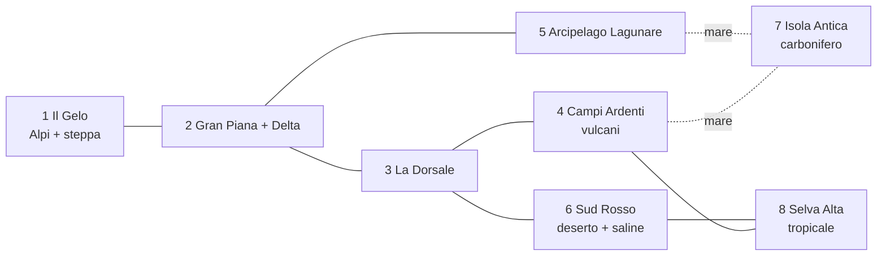

# Primeva - 04. Mondo e Biomi

> Documento di design (mondo, geologia, generazione procedurale). Titolo di lavoro del gioco: **Primeva**.
> Dati macchina: `/home/user/idao/primeva/data/world/biomes.json` (25 biomi) e `/home/user/idao/primeva/data/world/proposed_materials.json`.
> Stato: bozza v0.1 per revisione. Le cifre sono ordini di grandezza motivati, non misure; vanno validate con prototipi.

## 0. Sintesi esecutiva (da leggere se si ha 1 minuto)

1. **Una mappa di 301.000 km2 a 1:1 non e una buona idea per un survival/taming.** E circa 2.000-6.000 volte piu grande di un'isola ARK o di una mappa Rust. A piedi servono 2-3 giorni di gioco continuo per attraversarla; con 70-150 giocatori la densita e di 1 giocatore ogni 2.000-4.000 km2. Il rischio e il "Daggerfall effect": un mondo enorme, tecnicamente impressionante e quasi vuoto.
2. **Raccomandazione**: tenere il *telaio macro* di dimensione italiana (la bake macro lo sopporta bene: 30 M celle a 100 m), ma rendere **giocabile ad alta densita solo ~2.000-3.000 km2** distribuiti in **8 nuclei** (cores) di 150-500 km2, separati da mare, valichi e "Orli" selvaggi. Il resto e mare aperto, ghiacciaio, deserto e fondale: tutto *scavabile e navigabile*, ma con contenuto sparso e destinato al late game, ai voli lunghi e alle stagioni di "esplorazione".
3. **Prima di tutto la fetta verticale**: un blocco di **4 x 4 km (16 km2)** con tre biomi di superficie, un fiume, un lago, un sistema carsico e un tubo di lava, dal cielo a -300 m. Se quel blocco non e bello e divertente, nessuna scala lo salvera.
4. **Giustificazione in-world**: il continente *Tessera* e un mosaico di rifugi temporali ancorati da "Pilastri di Eone" (Sezione 0.1).

### 0.1 Lore: il Mosaico di Tessera

Sotto la crosta di Tessera giace il **Nucleo di Eone**, un enorme ammasso di un minerale cristallino mai visto altrove, la **cronite**. Quando, in un'epoca perduta, il Nucleo ha "fratturato" il tempo locale (la *Frattura Lenta*), la superficie non e stata spazzata via ma *scomposta in tessere*: porzioni di mondo sono rimaste ancorate a ere diverse della storia della vita. Ogni tessera e tenuta ferma da un **Pilastro di Eone**, una guglia di cronite alta decine di metri visibile da lontano per il suo lieve scintillio azzurro. Dove i campi di due Pilastri si sovrappongono nasce un **Orlo**, una fascia di 1-4 km dove le ere si fondono: i climi si mescolano, la flora si ibrida, le creature migrano e la bruma ha un odore di rame. Gli Orli sono i luoghi in cui il gioco ha il suo contenuto piu pericoloso e piu prezioso (cronite, creature di due ere).

Perche funziona per il design:
- giustifica **biomi di ere diverse a contatto** (con regole di transizione esplicite, sezione 3);
- giustifica la **scavabilita totale** (la cronite e nel sottosuolo: scavare = avvicinarsi al segreto);
- fornisce **late game**: spezzare/ricomporre i Pilastri cambia davvero il bioma (evento dinamico opzionale);
- e **originale**: nessun "ARK", nessun artefatto/obelisco-spedizione; il registro e geologico/misterioso, non tecnologico.

Nota alternativa se si preferisce meno magia: *rifugi isolati* (come i veri refugia glaciali) mantenuti da microclimi stabili a causa di sorgenti geotermiche e mari interni; la cronite resterebbe solo estetica. L'architettura dati non cambia.

---

## 1. Analisi di fattibilita: una mappa grande come l'Italia

### 1.1 Numeri di partenza

- Area target: ~301.000 km2, cioe un quadrato di circa 549 x 549 km.
- Voxel di 0,125 m (8 voxel per metro): una colonna di 1 km2 contiene 64 milioni di colonne di superficie. Con 2 km di profondita sarebbe ~10^12 voxel/km2 se fossero tutti memorizzati. **Non lo saranno mai**: il mondo non modificato e rigenerato in modo deterministico dalla bake macro + rumore; si persistono solo i *delta* (chunk modificati).
- Bake macro: a 100 m ci sono 30 milioni di celle (5.490 x 5.490); a 50 m 120 milioni. Con 10-14 canali (quota, roccia, umidita, temperatura, bioma, flusso ecc.) sono 0,7-2 GB per tutto il telaio: **fattibile**. Il collo di bottiglia non e il calcolo ma il **contenuto** e la **rete**.

### 1.2 Tempi di attraversamento (rettilineo, senza ostacoli, 549 km lato-lato)

| Modalita | Velocita media realistica | Tempo lato-lato | Diagonale (776 km) |
|---|---|---|---|
| A piedi, camminata | 5,5 km/h | ~100 h | ~141 h |
| A piedi, corsa con stamina | ~9 km/h | ~61 h | ~86 h |
| Cavalcatura terrestre (galoppo sostenuto) | 25 km/h | ~22 h | ~31 h |
| Cavalcatura veloce (burst + recupero) | 40 km/h | ~14 h | ~19 h |
| Volante medio | 90 km/h | ~6 h | ~8,6 h |
| Volante veloce (burst, late game) | 160 km/h | ~3,4 h | ~4,9 h |

Considerazioni: un tragitto ragionevole per una sessione di gioco e **5-20 minuti** tra due punti d'interesse. A 25 km/h cio corrisponde a 2-8 km. Quindi la densita giusta sono POI ogni 1-3 km nei nuclei. Una mappa di 549 km di lato richiederebbe, in un'ora di volo, di passare su ~90 km senza trovare niente di diverso da "altro bioma uguale".

### 1.3 Confronto con altre mappe (ordini di grandezza)

| Gioco | Area approssimata | Note |
|---|---|---|
| Rust | 4-16 km2 | altissima densita di giocatori (~15/km2) |
| Skyrim | ~37 km2 | ~10 luoghi/km2 scritti a mano |
| ARK (The Island) | ~50-70 km2 | ~1-2 giocatori/km2 con 70 slot |
| Red Dead Redemption 2 | ~75 km2 | densita narrativa/animazioni elevatissima |
| Elden Ring | ~80 km2 | verticalita, poche "zone vuote" |
| Valheim | ~314 km2 (raggio 10 km) | procedurale, mondo spesso vuoto e il gioco lo sa |
| Arma 3 (Altis) | ~270 km2 | simulazione, non esplorazione |
| Just Cause 3 | ~1.000 km2 | grande ma poco denso; molta area "scenografica" |
| Kenshi | ~870 km2 | molto vuoto, riuscito perche sandbox lento |
| Daggerfall | ~160.000 km2 | l'esempio classico di mondo enorme e spopolato |
| **Primeva (proposta literale)** | **301.000 km2** | 4.000-6.000 volte ARK |

### 1.4 Densita di contenuto: il conto onesto

Un POI (punto d'interesse: nido, rovina, grotta, sorgente, carcassa, miniera, tomba) ben fatto per un team piccolo-medio costa da 2 ore (kit modulare + PCG) a 3 giorni (hand-authored). Ipotesi ottimistica: **5.000 POI assemblati da kit + 20.000 micro-POI procedurali** (affioramenti, carcasse, tane) nel corso dello sviluppo.

- Su 301.000 km2: 25.000 / 301.000 = **0,083 POI/km2**, uno ogni ~3,5 km in media (con distribuzione irregolare, spesso 15-20 km). A piedi significa ore senza vedere nulla di nuovo. **Mondo vuoto.**
- Su 2.500 km2 di nuclei: 25.000 / 2.500 = **10 POI/km2**, paragonabile a Skyrim: esplorare e sempre premiante.

Inoltre ogni creatura "taming" ha bisogno di territorio, ecologia e catena alimentare plausibile: una specie ogni N km2 e la densita biologica. 25 biomi x ~12 specie = ~300 specie; se ogni specie ha 3-5 nicchie utili, serve minimo 5-10 individui/km2 nei nuclei per avere esperienza giocabile. A scala Italia sono 3 M di creature: simulabile solo come **dati aggregati (ecologia statistica)**, non come entita attive.

### 1.5 Popolazione server

70-150 giocatori su 301.000 km2 e 1 giocatore ogni 2.000-4.300 km2: incontri tra giocatori praticamente nulli, nessuna tribu avra vicini. Con 2.500 km2 e 100 giocatori: 1 ogni 25 km2 (~5 km di distanza media): sufficiente a dare senso di mondo condiviso senza soffocare. ARK e ~1 ogni 0,7-1 km2, Rust ~1 ogni 0,07 km2. Per un survival cooperativo/PvE, **10-40 km2 per giocatore** e una buona fascia; per PvP spinto serve 5-10 volte meno.

Per questo il design prevede **hub fissi di spawn per nucleo**, e il bilanciamento delle risorse sara per nucleo, non per mappa.

### 1.6 Costi tecnici che crescono con l'area (non solo il contenuto)

- **Streaming e LOD**: raggio di visibilita 4-8 km richiede un clipmap voxel con LOD che raddoppia ogni anello (0,125 m fino a ~64 m, 0,25 m a 128 m, 0,5 m a 256 m ... 64 m oltre 16 km). Il lontano e un'altimetria (heightfield + atlas materiali) pre-baked.
- **Server**: un server autoritativo che gestisce voxel + fisica + 2.500 km2 di mondo attivo e plausibile con *sharding spaziale* (un processo per nucleo). 301.000 km2 attivi non lo sono.
- **Persistenza**: 100 giocatori che scavano producono 5-50 GB di delta in un mese; con 8 nuclei partizionati e gestibile (chunk 32^3 o 64^3 compressi RLE/zstd).
- **Bake**: 301.000 km2 si cuociono in un'ora su GPU, ma ogni correzione di design richiede ricuocere. Bake gerarchica: 100 m ovunque, 50 m nei nuclei, raffinamento 12,5 m solo nella fetta verticale.
- **QA e bilanciamento**: ogni km2 giocabile va testato (navmesh, spawn, volo, fisica di cave-in). La superficie testabile e finita.

### 1.7 Raccomandazione (in disaccordo con il brief letterale)

**Strategia "arcipelago di nuclei in un telaio italiano".**

1. *Telaio macro*: 301.000 km2 (o ~150.000 km2 se si taglia l'oceano periferico), cuociuto a 100 m. Contiene tutta la geologia: spina montuosa, arco alpino, pianura, distretti vulcanici, mari interni. E l'**ossatura narrativa e visiva**: dall'alto di una vetta si vedono i profili di altri nuclei.
2. *Otto nuclei giocabili* (150-500 km2 ciascuno, totale ~2.500 km2, cioe 0,8% del telaio), uno per macro-regione. Dentro il nucleo: densita 8-12 POI/km2, fauna completa, sottosuolo completo (-2000 m).
3. *Orli e Selve* tra i nuclei: fasce di 20-80 km con densita 0,5-1 POI/km2, vuoto *intenzionale* e attraversabile (sorvolo 10-25 minuti; viaggio terrestre 1-3 ore). Sono tratti narrativi (rovine in sparsa dispersione, caravanserragli, "porti del Pilastro").
4. *Mare aperto*: usato come isolante tra nuclei e come contenuto (navigazione, isole di rifugio, creature pelagiche); coprono ~55% del telaio, a costo quasi nullo.
5. *Late game*: solo dopo il lancio si "aprono" nuovi nuclei (DLC/stagioni) nello stesso telaio. Il telaio gia c'e: espandere e solo riempire. E il vero vantaggio di fare una bake italiana.
6. *Viaggio rapido*: non teletrasporto ma "Corridoi di Eone" (mini-meccaniche costruibili) tra Pilastri: tempo reale 3-5 min.

**Scelta alternativa piu prudente (da valutare)**: scala 1:10 lineare dell'Italia (55 x 55 km = ~3.000 km2) con *tutto* giocabile e denso. Si perde la verosimiglianza geografica (le Alpi diventano rilievi di 4 km in 30 km: troppo ripide) ma si guadagna un mondo coerente e riempibile. Se il cliente insiste su "grande come l'Italia", la soluzione 1.7 offre la narrativa senza il vuoto.

### 1.8 Fetta verticale: "Il Bivio del Fiume" (4 x 4 km)

Costruire per prima questa regione, in un Orlo (cosi si prova la transizione tra ere):

- **Dimensione**: 4 x 4 km = 16 km2, 125.000 chunk di superficie (32 m) fino a -300 m; ~400 K chunk attivi massimi con streaming.
- **Biomi**: `jurassic_fern_prairie` (60%), `jurassic_araucaria_forest` (30%), `cretaceous_floodplain_delta` (10% con un meandro e lanche). Un lago di faglia (`triassic_rift_lakes` come mini-bacino di 400 m) per provare acqua e pesca.
- **Quote**: da 40 m (fiume) a 360 m (cresta di calcare).
- **Sotterraneo**: `karst_caves` (3 saloni, un pozzo di 60 m, un sifone), `underground_rivers` (un corso di 900 m che emerge come sorgente), un `lava_tubes` di 600 m e **una** geode (`crystal_geode_caverns`) a -140 m. Fungal solo come sala secondaria a -250 m.
- **Contenuto**: 3 nidi, 2 tane di predatori da imboscata, 1 sito di cronite, 1 piccola miniera, 1 villaggio-base, ~40 micro-POI procedurali, 6 specie di taming, 1 evento dinamico (piena del fiume).
- **Obiettivi tecnici** (go/no-go): 60 FPS su PC mid (RTX 3060 / 16 GB), visuale di 3 km, scavo e crollo senza hitch > 8 ms, 20 giocatori sul server, Lumen su mesh runtime stabile (sezione 6).
- **Tempo stimato**: 8-12 settimane con 4-6 persone (1 world designer/tech artist, 1 programmatore voxel, 1 PCG/tech artist, 1 environment artist, 1 audio/VFX a mezzo tempo).

---

## 2. Layout macro del continente

### 2.1 Ispirazione e principi

Il telaio e ispirato alla geomorfologia italiana ma volutamente *non* una copia: l'orientamento e ruotato, i nomi sono originali, le proporzioni cambiano.

- **Arco alpino** a nord (collisione continentale, glaciazione): `pleistocene_glacial_alps`.
- **Spina montuosa** lunga ~420 km diretta NO-SE (come gli Appennini): "la Dorsale", calcari e flysch, con altopiani carsici e catene parallele; a metterci bacini intermontani con laghi (graben).
- **Grande pianura alluvionale** (come la Padana) tra l'arco e la Dorsale, drenata da un fiume maggiore verso un mare interno a est.
- **Distretti vulcanici** (come Colli Albani-Campi Flegrei-Vesuvio-Eolie): un campo vulcanico sul versante tirrenico e un arco di isole vulcaniche a sud.
- **Altopiani carsici** (come il Carso, le Murge, la Majella): sopra grandi acquiferi, sede di `karst_caves`.
- **Isola granitica** a ovest (come Sardegna): crosta antica, graniti, carbone.
- **Sud arido** (come l'entroterra siciliano): deserto e saline.
- **Mari interni**: *Mare di Mezzo* (ovest), *Golfo Pallido* (est, con delta), *Mare delle Lame* (sud).

### 2.2 Schema ASCII (Nord in alto; 1 colonna = 10 km, 1 riga = ~20 km)

```
          0   50  100 150 200 250 300 350 400 450 500 km
        N +----------------------------------------------------+
  (oceano)|~~~~~~~~~~~~~~~~~~~~~~~~~~~~~~~~~~~~~~~~~~~~~~~~~~~~~|
          |~~~~~/\/\/\/\/\/\/\/\/\/\/\/\/\/\/\/\/\/\/\~~~~~~~~~~|  A = ALPI (glacial)
          |~~~~~/\AAAAAAAAAAAAAAAAAAAAAAAAAAAAAAAAAAAA\sssss~~~~|  s = steppa del gelo
          |~~~~~~~ssAAAAAAAAAAAAAAAAAAAAAAAAAAAAAAAAssssssss~~~~|
          |~~~~~~~~~ppppppppppppppppppppppppppppppppdd~~~~~~~~~~|  p = GRAN PIANA
          |~~~~~~~~~pppppppppppFFFFFFFpppppppppppppdddd~~~~~~~~~|  F = foresta angiosp.
          |~~~LL~~~~~~~~~~~~~~~~~~~~~~~~~~~~~~~~~~~~~dddd~~~~~~~|  d = delta/estuari
          |~~LLLL~~~~~ MARE DI MEZZO ~~~~~~~~DDDDDD~~~~~~~~~~~~|  D = Dorsale ->
          |~~LLCC~~~~~~~~~~~~~~~~~rrDDDDDD~~~~~~~~~~~~~~~~~~~~~|  r = rift laghi
          |~~CCCC~~~~~vv~~~~~~~~~~~~rrDDDKKDDD~~~~~~~~~~~~~~~~~|  K = altopiani karst
          |~~~~~~~~~~~vvv~~~~~~~~~~~~~DDDDKKDDD~~~~~~~~~~~~~~~~|  v = Campi Ardenti
          |~~~~~~~~~~~~~~~~~~~~~~~~~~~~~~~~DDDDDD~~~~~~~~~~~~~~~|
          |~~~~vv~~~~vv~~~~~~~~~~~~~~~~~~~~TTTDDD~~~~~~~~~~~~~~|  T = foresta tropicale
          |~~~~~~~~~~~~~~~~~~~~~~RRRRRRR~~~~~TTTTDD~~~~~~~~~~~~|  R = deserto rosso
          |~~~~~~~~~~~~~~~~~~~~~~RRRRssRRR~~~~~~~~~NNNN~~~~~~~~~|  N = savana neogene
          |~~~~~~~~~~~~~~~~~~~~~~~~~~~~~~~~~~~~~~~~~~NN~~~~~~~~~|
        S +----------------------------------------------------+
  Isole: LL = lagune (giurassico)   CC = isola carbonifera (granito)
         vv = isole vulcaniche (arco meridionale)
```

*Lo schema e indicativo; la forma vera esce dalla bake tettonica (2.5).*

### 2.3 Le 8 regioni giocabili (i nuclei)

| # | Nucleo | Ere/biomi dominanti | Area target | Posizione (centro) | Concetto |
|---|---|---|---|---|---|
| 1 | **Il Gelo** | glacial_alps, mammoth_steppe, araucaria alta | 450 km2 | Nord, arco alpino | Alta quota, caccia e sopravvivenza dura; ghiacciai con grotte ghiacciate |
| 2 | **La Gran Piana e il Delta** | floodplain_delta, angiosperm_forest, chalk_coast | 500 km2 | Centro-nord | Fiume maggiore, migrazioni, grande taming erbivori; piene |
| 3 | **La Dorsale** | araucaria_forest, fern_prairie, rift_lakes, badlands | 450 km2 | Spina centrale | Verticalita, valli, laghi rift, karst esteso; hub per le gallerie |
| 4 | **Campi Ardenti** | volcanic_highlands, angiosperm_forest, lava_tubes | 300 km2 | Costa tirrenica | Vulcani attivi, eruzioni, lava, zolfo; tubi di lava; magma |
| 5 | **Arcipelago Lagunare** | lagoon_archipelago, reef_sea, chalk_coast | 250 km2 (+mare) | Ovest | Navigazione, creature acquatiche, spiagge; barca/volo |
| 6 | **Il Sud Rosso** | red_desert, salt_flats, savanna | 300 km2 | Sud | Calore, acqua rara, tempeste, saline; caverne profonde |
| 7 | **L'Isola Antica** | coal_swamp, giant_fern_forest | 200 km2 | Ovest isolata | Carbonifero: artropodi giganti, carbone, ossigeno alto |
| 8 | **La Selva Alta** | paleogene_rainforest, savanna | 250 km2 | Sud-est peninsula | Canopea, liane, verticalita vegetale; tropici |

Totale ~2.700 km2.

### 2.4 Grafo di adiacenza dei nuclei e viaggi



Distanze indicative tra i centri: 80-180 km (volo 1-2 h; mount 4-7 h; mare con barca veloce 3-6 h). I nuclei confinanti sono collegati da **corridoi** (valichi, guadi, ponti di roccia) larghi 5-15 km e sempre tracciabili.

### 2.5 Pipeline di bake macro (ordine delle fasi)

1. **Tettonica a placche semplificata**: 3-4 placche, collisione a nord (arco), subduzione a ovest (vulcani, bacino arco-retro), rift a centro-est (graben, laghi). Campo di sollevamento U(x,y) in m/Ma.
2. **Quota di base**: integrazione di U + isostasia; poi rumore multi-ottava (ridged + fbm) modulato dalla litologia.
3. **Erosione**: *stream-power* + hillslope diffusion + erosione termica (sezione 3.0), 300-800 iterazioni su griglia 100 m; frana del versante.
4. **Idrologia**: pit-filling, flow-accumulation (D8 + D-infinity), estrazione rete fluviale con soglia di 5 km2; laghi nei pit con profondita > 1 m.
5. **Clima**: temperatura = f(latitudine, quota, continentalita, era); precipitazione = orografia su vento prevalente (Smith-Barstad semplificato), ombra pluviometrica a est della Dorsale.
6. **Assegnazione del bioma**: *Whittaker modificato* + maschere d'era (campi dei Pilastri: diagrammi di Voronoi pesati con rumore) + vincoli (spiagge sul bordo, vulcanico sopra camere magmatiche).
7. **Geologia 3D**: stratigrafia per colonna (sezione 4.1), faglie, intrusioni, condotti vulcanici, falde acquifere.
8. **Mappe di rumore di dettaglio**: semi per bioma, mappe di maschere (humus, bagnato, sassosita, ruscellamento) a 50 m, in formato texture 16 bit per il runtime.

### 2.6 Rete idrografica

- **Eridano** (fiume maggiore): origina nel ghiacciaio dell'arco, 520 km, attraversa la Gran Piana, delta a est (distributari 8-14).
- **Dorsale**: 14 fiumi pettinati ad est e ovest (bacini 200-2.000 km2).
- **Laghi**: 4 laghi rift (profondi 80-300 m), 6 laghi pro-glaciali al piede dell'arco (profondi 150-350 m, stile Garda/Como), 40+ laghi minori.
- **Sotterranei**: 3 sistemi carsici maggiori; sorgenti carsiche di portata 2-20 m3/s.

---

## 3. I biomi: convenzioni e schede

### 3.0 Convenzioni dei parametri del generatore

Tutti i parametri sono nel file `biomes.json` e sono letti dalla bake e dal generatore runtime.

- **`elevation_m`**: quota assoluta sul livello del mare (superficie). Per i biomi sotterranei, `elevation_m` e la gamma di quote in cui il bioma esiste e `depth_m` e la profondita sotto la superficie locale.
- **`base_noise`**: famiglia di rumore: `fbm_simplex` (OpenSimplex2S, lacunarity 2.0, gain 0.5), `ridged_multifractal` (|n| invertito, gain 0.55-0.65, offset 1.0), `billow` (|n|), `worley` (F1, F2-F1), `domain_warped_fbm` (warp con ampiezza 0.3-0.6 della lunghezza d'onda base), `terrace` (quantizzazione per faglie a gradini).
- **`frequency_per_km`**: cicli per km della prima ottava; la lunghezza d'onda base e 1000/f metri (es. 1.2 -> ~830 m). Ogni ottava successiva raddoppia la frequenza (lacunarity 2) e dimezza l'ampiezza (gain 0.5) salvo diversa indicazione.
- **`octaves`**: nella bake macro si usano tutte; nel runtime micro-detail si aggiungono altre 4-6 ottave fino a ~0,5 m (con tetto a 8 ottave totali visibili per LOD).
- **`amplitude_m`**: ampiezza picco-picco della prima ottava. L'altezza totale e somma pesata delle ottave piu la base macro.
- **`ridge`**: 0 = nessun ridge, 1 = rumore ridged puro; interpola `lerp(fbm, ridged, ridge)`.
- **`erosion`**: 0..1: scala l'effetto dell'erosione macro. Valori: 0.0-0.2 poco eroso (piane, saline); 0.3-0.6 collinare; 0.7-0.9 molto inciso (badlands, ghiacciai). In pratica moltiplica il coefficiente *stream-power* K (m^(1-2m)/anno) e l'intervallo di iterazione della diffusione.
- **Erosione idraulica** (bake): legge stream-power `dz/dt = U - K A^m S^n` con m = 0.45, n = 1 (K base 1.5e-6, vedi per bioma); in piu, erosione *particle-based* a 12,5 m nelle fette di dettaglio (500-3.000 gocce/km2).
- **Erosione termica** (talus): angolo di riposo per materiale (sand 32 deg, gravel 36 deg, clay 25 deg, shale 40 deg, sandstone 55 deg, limestone 65 deg, granite 75 deg, basalt 70 deg, ash 28 deg, snow 35 deg).
- **`material_stack`**: strati dall'alto verso il basso (dalla superficie), spessore in metri; l'ultimo strato si estende fino alla base locale (`bedrock` e sempre sotto -2000 m).
- **`flora.density`**: `molto bassa` < 5 istanze/ha, `bassa` 5-40, `media` 40-200, `alta` 200-800, `molto alta` > 800 (piccole piante / ciuffi); per alberi la banda e circa 1/5.
- **Transizioni (regola generale)**: peso di bioma `w_i` ottenuto da Whittaker + distanza dai Pilastri; fascia di sfumatura `w = smoothstep(d / W)` con W = 500-2.000 m (Orlo: 1-4 km); rumore di soglia `n_t` (cellular + fbm) sposta il confine di +-30% per evitare linee dritte; la selezione per cella usa un hash stabile (seed del mondo, cella, bioma) cosi l'ecotono e deterministico. In una fascia di transizione la flora si estrae da entrambe le liste con probabilita proporzionale ai pesi e le specie "ibride" (Orlo) compaiono con probabilita `0.35 * w1 * w2`.

### 3.0.1 Elenco biomi e ruolo

| id | era | ruolo di design |
|---|---|---|
| carboniferous_coal_swamp | Carbonifero | carbone, artropodi giganti, torba |
| carboniferous_giant_fern_forest | Carbonifero | legno, felci, base di sviluppo di tribu |
| permian_red_desert | Permiano | calore, sabbia, ferro/rame |
| permian_salt_flats | Permiano | sale, zolfo, estremi |
| triassic_conifer_badlands | Triassico | calanchi, fossili, frane |
| triassic_rift_lakes | Triassico | laghi, pesca, sismi |
| jurassic_fern_prairie | Giurassico | prateria, erbivori, taming base |
| jurassic_araucaria_forest | Giurassico | foresta, verticalita, grotte |
| jurassic_lagoon_archipelago | Giurassico | costa, barca, scogliera |
| cretaceous_floodplain_delta | Cretaceo | fiume, piene, migrazioni |
| cretaceous_angiosperm_forest | Cretaceo | primi fiori, cibo, caccia |
| cretaceous_volcanic_highlands | Cretaceo | vulcani, eruzioni, zolfo |
| cretaceous_chalk_coast | Cretaceo | falesie, grotte marine |
| paleogene_tropical_rainforest | Paleogene | canopea, liane, malattie |
| neogene_savanna | Neogene | praterie con erba vera, predatori veloci |
| pleistocene_mammoth_steppe | Pleistocene | gelo, megafauna |
| pleistocene_glacial_alps | Pleistocene | alta quota, ghiaccio |
| shallow_reef_sea | multiepocale | scogliere, pesca |
| open_ocean_pelagic | multiepocale | profondita, navigazione |
| karst_caves | Cenozoico | grotte, calcare |
| lava_tubes | Cretaceo-Paleog. | basalto, tunnel |
| crystal_geode_caverns | Cenozoico | cristalli, endgame |
| underground_rivers | Quaternario | acque sotterranee |
| fungal_deep_caverns | multiepocale | ecosistema ipogeo luminoso |
| abyssal_magma_depths | Hadeano | magma, limite del mondo |

**Nota sulla flora per era**: le *graminacee vere* (`neogene_savanna`, steppa) compaiono solo dal Neogene in poi; prima di allora i "prati" sono di felci, equiseti, cicadee o muschio. I fiori sono presenti solo dal Cretaceo superiore. Le conifere esistono dal Permiano; le araucarie dal Giurassico; i licopodi giganti solo nel Carbonifero. Questa regola e un vincolo del PCG (liste ammesse per era).

### 3.1 Schede per bioma

Le schede qui sotto sono generate dal file dati e riportano tutti i parametri. I dettagli narrativi (forma del terreno, suono, luce, regole di transizione) sono voluti: servono sia a designer che a tech artist.


### Gruppo: Superficie

#### `carboniferous_coal_swamp`
*Carbonifero (c. 320 Ma) - livello: surface*

Piana costiera quasi piatta (pendenza 0-1 deg) con migliaia di bacini poco profondi, canali anastomizzati e isolotti di torba galleggiante. L'acqua occupa 40-55% della superficie; il suolo e soffice e cede.

| Parametro | Valore |
|---|---|
| Clima | 24..33 C, 2600 mm/anno |
| Quota | -2..8 m |
| Rumore base | domain_warped_fbm + billow; freq 0.8/km; 4 ottave; ampiezza 6 m; ridge 0.0; erosione 0.1 |
| Stack materiali (dall'alto) | peat 3 m, mud 6 m, clay 5 m, coal 2 m, shale 25 m, sandstone 40 m |
| Flora/fauna sessile | Lepidodendro scaglioso (Scalaria) [Lepidodendron / Sigillaria, alta]; Calamite a canne (Calamarya) [Calamites, alta]; Felce arborea palustre (Pteridarca) [Psaronius, media]; Muschio-lycopode strisciante [Selaginella, alta] |
| Risorse | coal, peat, clay, iron_ore (noduli di siderite), resina fossile (proposta) |
| Pericoli | acque stagnanti ipossiche, gas di palude infiammabile (metano), sabbie mobili di torba, insetti giganti aggressivi, incendi di torba |
| Palette | cielo #9db79a, nebbia #7f9a7a, suolo #3b3a2a |
| Suono | Gracidare profondo di anfibi giganti, ronzio di libellule dal volo pesante, bolle di metano, goccia continua dalle fronde, vento quasi assente. |
| Luce/atmosfera | Luce verde-oro filtrata, nebbia basale densa (visibilita 80-250 m), umidita percepibile, raggi volumetrici sotto le chiome a 8-15 m. |
| Transizioni | Verso carboniferous_giant_fern_forest: torba -> grass_soil in 300-600 m risalendo di 2-4 m. Verso shallow_reef_sea: mangrovieto di calamiti poi sabbia in 150 m. |
| Vicini | carboniferous_giant_fern_forest, shallow_reef_sea |

#### `carboniferous_giant_fern_forest`
*Carbonifero (c. 310 Ma) - livello: surface*

Colline basse arrotondate, versanti 3-15 deg, valli a V larghe con torrenti marroni. Foresta continua a tre strati: canopea a 25-35 m, sottobosco di felci, suolo di lettiera.

| Parametro | Valore |
|---|---|
| Clima | 20..30 C, 2000 mm/anno |
| Quota | 5..120 m |
| Rumore base | fbm_simplex + ridged_multifractal (colline basse); freq 1.6/km; 5 ottave; ampiezza 55 m; ridge 0.25; erosione 0.35 |
| Stack materiali (dall'alto) | topsoil 0.4 m, peat 0.8 m, grass_soil 1.5 m, clay 3 m, shale 30 m, granite 200 m |
| Flora/fauna sessile | Felce arborea gigante (Titanofelce) [Psaronius / Dicksonia, alta]; Licopodio colonnare (Colonnaria) [Lepidodendron, alta]; Cordaite a nastro (Nastrofoglia) [Cordaites, media]; Equiseto gigante [Calamites / Equisetum, media]; Felcetta di sottobosco a semi (Semenfelce) [Medullosa / Neuropteris, alta] |
| Risorse | coal (strati di 0.5-3 m a -5/-60 m), iron_ore, clay, legno fossile |
| Pericoli | artropodi giganti, ossigeno alto: fulmini e incendi di sottobosco rapidi, frane di argilla in pendio dopo piogge |
| Palette | cielo #a9c3a0, nebbia #8fae8c, suolo #4a4a30 |
| Suono | Cori di insetti, stridio di grandi artropodi volanti, scricchiolio dei fusti, scrosci di pioggia pesante sulle fronde larghe. |
| Luce/atmosfera | Penombra smeraldo, luce a macchie, nebbia di valle al mattino, pioggia quasi pomeridiana quotidiana, cielo basso e latteo. |
| Transizioni | Verso coal_swamp: quote scendono, felci lasciano posto a calamiti. Verso jurassic_araucaria_forest: sfumatura sopra i 120 m, licopodi diradano e compaiono conifere (200-500 m). |
| Vicini | carboniferous_coal_swamp, jurassic_araucaria_forest |

#### `permian_red_desert`
*Permiano (c. 270 Ma) - livello: surface*

Campi di dune lineari (seif) alternati a mesa e butte di arenaria rossa stratificata; wadi incisi 5-30 m. Ampiezza di dune 15-40 m, lunghezza d'onda 300-800 m.

| Parametro | Valore |
|---|---|
| Clima | 8..48 C, 150 mm/anno |
| Quota | 20..600 m |
| Rumore base | fbm_simplex + worley (mesa) + dune_noise anisotropo; freq 0.7/km; 5 ottave; ampiezza 90 m; ridge 0.45; erosione 0.55 |
| Stack materiali (dall'alto) | red_sand 2 m, red_sandstone 25 m, clay 3 m, red_sandstone 60 m, shale 40 m |
| Flora/fauna sessile | Cicadea nana a ciuffo (Ciuffocica) [Cycas / Glossopteris-like, bassa]; Gnetale tozzo (Welwitschiopsis) [Welwitschia, bassa]; Cespuglio di Walchia (Aghirosso) [Walchia / Lebachia, bassa]; Equiseto xerofilo [Equisetum, molto bassa] |
| Risorse | iron_ore (ematite), copper_ore (letti rossi), gypsum (proposto), fossili di sinapsidi |
| Pericoli | calore estremo (stress termico), tempeste di sabbia, dune migranti che sepolcrano, carenza d'acqua, flash flood nei wadi |
| Palette | cielo #e8c9a0, nebbia #d9b48a, suolo #b5532f |
| Suono | Vento costante con sabbia che sibila, tuoni secchi lontani, crepitio di rocce termiche a fine giornata, silenzio quasi totale di notte. |
| Luce/atmosfera | Cielo bianco-arancio, alto contrasto, miraggi termici, tramonti rosso fuoco, notti molto stellate e fredde (8 C). |
| Transizioni | Verso permian_salt_flats: quote scendono sotto i 20 m, sabbia -> argilla -> crosta salina (500 m). Verso triassic_conifer_badlands: la sabbia si indurisce in argilliti striate, comparsa di conifere sparse. |
| Vicini | neogene_savanna, permian_salt_flats, triassic_conifer_badlands |

#### `permian_salt_flats`
*Permiano (c. 255 Ma) - livello: surface*

Bacino endoreico depresso, quasi piatto (pendenza < 0.3 deg) con poligoni di sale di 1-3 m di diametro, pozze iper-saline colorate e vulcanelli di fango/zolfo (stile Dallol).

| Parametro | Valore |
|---|---|
| Clima | 12..52 C, 60 mm/anno |
| Quota | -80..10 m |
| Rumore base | billow poligonale (worley F2-F1) + piatto; freq 0.3/km; 3 ottave; ampiezza 4 m; ridge 0.0; erosione 0.05 |
| Stack materiali (dall'alto) | salt 3 m, mud 1.5 m, salt 6 m, clay 10 m, red_sandstone 40 m |
| Flora/fauna sessile | Alofita a cuscino (Cuscinsale) [Salicornia / Arthrocnemum, molto bassa]; Tappeto di alghe rosse (Rubrimat) [Dunaliella / tappeti microbici Danakil, bassa] |
| Risorse | salt (crosta polimorfa), sulfur (sorgenti acide), potassio (proposto), gypsum (proposto) |
| Pericoli | abbagliamento / cecita da neve di sale, pozze acide idrotermali, crosta che cede su salamoia, calore e disidratazione |
| Palette | cielo #f2ecdf, nebbia #e9dfce, suolo #efe9dc |
| Suono | Crepitio di cristalli di sale, vento secco, ronzio elettrostatico, gorgoglio di sorgenti calde. |
| Luce/atmosfera | Riverbero bianco accecante, orizzonte liquido, albe rosa-viola riflesse, pozze verdi/arancio fosforescenti. |
| Transizioni | Verso permian_red_desert: sale sporco -> sabbia (500 m). Verso shallow_reef_sea: sabkha, laguna ipersalina 1-2 km. |
| Vicini | permian_red_desert, shallow_reef_sea, triassic_rift_lakes |

#### `triassic_conifer_badlands`
*Triassico (c. 230 Ma) - livello: surface*

Calanchi, creste a lama e pinnacoli stile Calanchi di Atri / Badlands: reticolo di gole fitto (densita 8-14 km/km2), versanti 30-70 deg, strati rossi, viola e bianchi a bande da 0.5-3 m.

| Parametro | Valore |
|---|---|
| Clima | 10..38 C, 450 mm/anno |
| Quota | 80..900 m |
| Rumore base | ridged_multifractal + erosione idraulica pesante; freq 1.2/km; 6 ottave; ampiezza 160 m; ridge 0.7; erosione 0.85 |
| Stack materiali (dall'alto) | red_sandstone 4 m, clay 6 m, shale 12 m, red_sandstone 25 m, gravel 3 m, tuff 20 m |
| Flora/fauna sessile | Conifera di Voltzia (Voltzione) [Voltzia / Pelourdea, bassa]; Equiseto arboreo (Equisetone) [Neocalamites, media]; Felce a semi di calanco (Calancofelce) [Dicroidium, media]; Ginkgoale tozza [Ginkgoites, bassa] |
| Risorse | iron_ore, copper_ore, clay, gypsum (proposto), ossa fossili affiorate |
| Pericoli | frane e debris-flow, calanchi instabili (cedimento di cornici), piene improvvise, terreno esposto al sole |
| Palette | cielo #cfa77e, nebbia #c4a78a, suolo #a6573a |
| Suono | Sassi che rotolano, fruscio di conifere secche, vento nelle gole, echi lunghi. |
| Luce/atmosfera | Luce dura e radente, bande cromatiche vistose, cielo azzurro polveroso, forte ombra proiettata nelle gole. |
| Transizioni | Verso triassic_rift_lakes: i calanchi digradano in conoidi di ghiaia e poi in rive di fango (1-2 km). Verso jurassic_araucaria_forest: copertura forestale cresce con la quota/umidita. |
| Vicini | cretaceous_volcanic_highlands, jurassic_araucaria_forest, permian_red_desert, triassic_rift_lakes |

#### `triassic_rift_lakes`
*Triassico (c. 220 Ma) - livello: surface*

Graben allungato (larghezza 6-18 km): serie di laghi profondi 20-300 m separati da orsti a gradino alti 80-250 m; scarpate di faglia nette e ripide (60-85 deg).

| Parametro | Valore |
|---|---|
| Clima | 14..34 C, 900 mm/anno |
| Quota | 150..700 m |
| Rumore base | fbm_simplex + faglie a gradini (terrace) + worley bacini; freq 0.9/km; 5 ottave; ampiezza 120 m; ridge 0.4; erosione 0.5 |
| Stack materiali (dall'alto) | mud 1.5 m, sand 2 m, clay 5 m, shale 25 m, sandstone 50 m, basalt 30 m |
| Flora/fauna sessile | Cicadeoide a candelabro (Candelabrica) [Cycadeoidea / Pterophyllum, media]; Canna di Neocalamite lacustre [Neocalamites, alta]; Conifera di sponda (Rivierona) [Voltzia / Brachyphyllum, media]; Alghe filamentose bentoniche [Charophyta, alta] |
| Risorse | clay, oil_shale (proposto), iron_ore, copper_ore (vene di basalto), pesci fossili |
| Pericoli | sismi e frane da faglia attiva, gas in solfuro dai laghi stratificati (limnic eruption), ghiaccio sottile in inverno |
| Palette | cielo #9fc0d3, nebbia #a8c3cf, suolo #6b5b4a |
| Suono | Onde di lago, urla di uccelli primordiali, scricchiolii tettonici sordi, gracidii. |
| Luce/atmosfera | Aria limpida, specchi d'acqua turchesi, riflessi netti, nebbie mattutine sui laghi, tramonti dorati sui gradini. |
| Transizioni | Verso triassic_conifer_badlands: ghiaia di conoide. Verso jurassic_fern_prairie e jurassic_araucaria_forest: la copertura a felci prende il posto dei calanchi. |
| Vicini | jurassic_araucaria_forest, jurassic_fern_prairie, permian_salt_flats, triassic_conifer_badlands, underground_rivers |

#### `jurassic_fern_prairie`
*Giurassico (c. 165 Ma) - livello: surface*

Vaste distese ondulate (pendenza 1-8 deg) con boschetti sparsi, laghetti e ruscelli meandriformi; nessuna erba vera: tappeto di felci a 0.4-1.2 m con alberi isolati.

| Parametro | Valore |
|---|---|
| Clima | 14..30 C, 1000 mm/anno |
| Quota | 10..300 m |
| Rumore base | fbm_simplex a bassa frequenza + billow; freq 0.5/km; 4 ottave; ampiezza 45 m; ridge 0.1; erosione 0.45 |
| Stack materiali (dall'alto) | grass_soil 0.6 m, topsoil 0.7 m, clay 3 m, limestone 25 m, shale 40 m |
| Flora/fauna sessile | Prateria di felci basse (Pratofelce) [Matoniaceae / Osmunda, molto alta]; Cicadee a tronco (Bennettitale) [Williamsonia / Zamites, media]; Ginkgo isolato [Ginkgo / Baiera, bassa]; Equiseto di ruscello [Equisetites, media] |
| Risorse | clay, limestone, iron_ore (limonite), legno silicizzato |
| Pericoli | erba alta (agguati), incendi stagionali da fulmine in estate, pozzi carsici nascosti dalla felce |
| Palette | cielo #b6d3d9, nebbia #bcd0c8, suolo #6d8a4f |
| Suono | Fruscio di felci, richiami di erbivori lontani, vento largo, cicale. |
| Luce/atmosfera | Cielo alto e luminoso, nuvole cumuliformi, luce dorata, orizzonti molto aperti, visibilita 4-8 km. |
| Transizioni | Verso jurassic_araucaria_forest: boschetti si addensano risalendo. Verso cretaceous_floodplain_delta: terreno scende e diventa fangoso. Verso jurassic_lagoon_archipelago: dune basse, mangrovie di cicadofite. |
| Vicini | cretaceous_floodplain_delta, jurassic_araucaria_forest, jurassic_lagoon_archipelago, karst_caves, triassic_rift_lakes |

#### `jurassic_araucaria_forest`
*Giurassico (c. 160 Ma) - livello: surface*

Dorsale boscosa con creste arrotondate, versanti 15-35 deg, valli profonde (200-500 m), pareti calcaree sporgenti con doline e inghiottitoi. Alberi alti 50-80 m.

| Parametro | Valore |
|---|---|
| Clima | 8..27 C, 1400 mm/anno |
| Quota | 100..1200 m |
| Rumore base | ridged_multifractal + fbm_simplex; freq 1.4/km; 6 ottave; ampiezza 220 m; ridge 0.5; erosione 0.55 |
| Stack materiali (dall'alto) | topsoil 0.3 m, grass_soil 0.7 m, clay 2 m, limestone 60 m, shale 30 m, granite 300 m |
| Flora/fauna sessile | Araucaria colonnare (Colonnaraucaria) [Araucaria / Agathis, alta]; Cedro giurassico (Cedrosauro) [Brachyphyllum / Pagiophyllum, alta]; Cicadea nana da sottobosco [Zamia / Nilssonia, media]; Felce rampicante (Rampifelce) [Gleichenia / Lygodium, alta]; Ginkgo di versante [Ginkgo, bassa] |
| Risorse | limestone, marble (aureole di contatto), iron_ore, resina/ambra (proposta), legno |
| Pericoli | frane di versante, freddo notturno oltre i 900 m, cadute di rami grandi (ambra e conifere pesanti) |
| Palette | cielo #a9c6d6, nebbia #b3c8c4, suolo #4c5c3a |
| Suono | Vento tra le chiome, richiami lontani di pterosauri, sgocciolio, picchiettio di resina, ruscelli. |
| Luce/atmosfera | Raggi di luce obliqui tra fusti colonnari, nebbie nelle valli (80-300 m di visibilita), aria fresca e pulita. |
| Transizioni | Verso jurassic_fern_prairie: canopea si apre in boschetti. Verso cretaceous_angiosperm_forest: compaiono latifoglie arcaiche, frontiera mescolata 1-3 km. Verso pleistocene_glacial_alps: conifere nane, poi roccia e neve sopra 1600 m. |
| Vicini | carboniferous_giant_fern_forest, cretaceous_angiosperm_forest, jurassic_fern_prairie, karst_caves, pleistocene_glacial_alps, triassic_conifer_badlands, triassic_rift_lakes, underground_rivers |

#### `jurassic_lagoon_archipelago`
*Giurassico (c. 150 Ma) - livello: surface*

Centinaia di isole e banchi sabbiosi, lagune 1-8 m di profondita, barriera esterna. Aree emerse minori di 25% e quota max 40 m; canali di marea sinuosi.

| Parametro | Valore |
|---|---|
| Clima | 20..31 C, 900 mm/anno |
| Quota | -30..40 m |
| Rumore base | worley (isole) + fbm_simplex warping; freq 2.2/km; 4 ottave; ampiezza 18 m; ridge 0.2; erosione 0.3 |
| Stack materiali (dall'alto) | sand 1.5 m, limestone 8 m, chalk 6 m, limestone 30 m, clay 10 m |
| Flora/fauna sessile | Mangrovia di cicadofite (Rizocica) [Rhizophora-like / Bennettitales, alta]; Conifera costiera a bandiera (Sferzabrachio) [Brachyphyllum, media]; Alghe calcaree a stuoia [Girvanella / Solenopora, alta]; Cespuglio di felci litoranee [Matonia, media] |
| Risorse | limestone, chalk, sand, coral, sale marino (saline) |
| Pericoli | maree rapide con secche, tempeste tropicali, sabbie mobili di laguna, predatori acquatici di acque basse |
| Palette | cielo #9fd6d9, nebbia #b8dede, suolo #d9d3b5 |
| Suono | Ondine, cinguettii di pterosauri costieri, ticchettio di crostacei, risacca. |
| Luce/atmosfera | Luce zenitale intensa, acque turchesi trasparenti, riflessi caustici, nuvole frastagliate all'orizzonte. |
| Transizioni | Verso shallow_reef_sea: la laguna sprofonda a -10/-40 m con scogliere. Verso cretaceous_chalk_coast: falesie bianche. Verso jurassic_fern_prairie: cordone dunare. |
| Vicini | cretaceous_chalk_coast, jurassic_fern_prairie, karst_caves, shallow_reef_sea |

#### `cretaceous_floodplain_delta`
*Cretaceo (c. 95 Ma) - livello: surface*

Pianura alluvionale quasi piatta (0-0.5 deg) larga fino a 120 km, fiume maggiore meandriforme (larghezza 120-600 m, sinuosita 1.5-2.4), rami abbandonati, lanche, argini naturali di 1-3 m e delta a ventaglio con 8-14 distributari.

| Parametro | Valore |
|---|---|
| Clima | 16..34 C, 1700 mm/anno |
| Quota | -5..40 m |
| Rumore base | fbm_simplex a bassa frequenza + carving da rete fluviale (A* + meandro); freq 0.4/km; 4 ottave; ampiezza 12 m; ridge 0.0; erosione 0.7 |
| Stack materiali (dall'alto) | topsoil 0.5 m, mud 3 m, sand 4 m, clay 6 m, sandstone 30 m, shale 40 m |
| Flora/fauna sessile | Cipresso di palude (Taxodiopsis) [Taxodium / Metasequoia, alta]; Platano arcaico (Platanoide) [Platanites / Sapindopsis, media]; Ninfea gigante (Nenufara) [Nelumbites / Nymphaeales, alta]; Canneto di Equiseto [Equisetum, alta]; Felce acquatica [Salvinia / Azolla, alta] |
| Risorse | clay, sand, mud, iron_ore (limonite di palude), ambra (proposta), ossa e uova fossili |
| Pericoli | piene stagionali (vedi 5.3), fango profondo, predatori d'imboscata, zanzare giganti: malattie (debuff) |
| Palette | cielo #b7cfdd, nebbia #c6d1cf, suolo #7b6a4a |
| Suono | Gracchiare di migliaia di uccelli primitivi, bramiti di erbivori lontani, sciabordio, rane. |
| Luce/atmosfera | Orizzonti enormi, nubi alte, alba nebbiosa sul fiume, luce dorata sugli sciami di insetti, tramonti sul delta. |
| Transizioni | Verso cretaceous_angiosperm_forest: terrazzi sopraelevati, boscaglia (2-6 km). Verso cretaceous_chalk_coast e shallow_reef_sea: barre di foce, estuari. Verso pleistocene_mammoth_steppe: loess, quote in aumento (5-10 km). |
| Vicini | cretaceous_angiosperm_forest, cretaceous_chalk_coast, jurassic_fern_prairie, pleistocene_mammoth_steppe, shallow_reef_sea, underground_rivers |

#### `cretaceous_angiosperm_forest`
*Cretaceo superiore (c. 80 Ma) - livello: surface*

Foresta mista a pendenze dolci (4-20 deg), colline 50-300 m di dislivello; primi fiori, colori in primavera; sottobosco leggero e visibile.

| Parametro | Valore |
|---|---|
| Clima | 12..30 C, 1500 mm/anno |
| Quota | 20..500 m |
| Rumore base | fbm_simplex + ridged_multifractal sfumato; freq 1.8/km; 5 ottave; ampiezza 90 m; ridge 0.3; erosione 0.5 |
| Stack materiali (dall'alto) | topsoil 0.4 m, grass_soil 1 m, clay 3 m, sandstone 20 m, limestone 40 m, granite 250 m |
| Flora/fauna sessile | Magnolia primordiale (Magnolide) [Magnolia / Archaeanthus, alta]; Platano giganteo [Platanus / Sapindopsis, media]; Rampicante a fiori (Fiorirampa) [Liriodendrites / Vitaceae, media]; Palma nana (Chamaerops-like) [Sabalites, media]; Cicadea residua [Zamites, bassa] |
| Risorse | legno, frutti e bacche (cibo), limestone, ambra |
| Pericoli | alberi che cadono in tempesta, insetti impollinatori aggressivi (sciami), pendii saturi in autunno |
| Palette | cielo #b4d1e1, nebbia #b2c9b0, suolo #5a6a3b |
| Suono | Ronzio di api primitive, canto di piccoli dinosauri piumati, fruscio di foglie larghe, picchi. |
| Luce/atmosfera | Luce primaverile con fiori in mille colori, nebbie leggere, ombra fresca. |
| Transizioni | Verso cretaceous_volcanic_highlands: foresta si dirada verso la cenere (800 m). Verso paleogene_tropical_rainforest: latifoglie sempre piu dense. Verso neogene_savanna: boschi aperti, comparsa di graminacee. |
| Vicini | cretaceous_floodplain_delta, cretaceous_volcanic_highlands, jurassic_araucaria_forest, lava_tubes, neogene_savanna, paleogene_tropical_rainforest, pleistocene_mammoth_steppe |

#### `cretaceous_volcanic_highlands`
*Cretaceo superiore (c. 70 Ma) - livello: surface*

Distretto vulcanico con 4-9 stratovulcani (quota 1800-2200 m), calderette, coni di scorie, colate lisce e campi di lapilli; fumarole, laghi di cratere, pareti di tufo erose.

| Parametro | Valore |
|---|---|
| Clima | -2..28 C, 1100 mm/anno |
| Quota | 400..2200 m |
| Rumore base | ridged_multifractal + strato-vulcano (cono radiale) + worley (caldere); freq 1.0/km; 6 ottave; ampiezza 700 m; ridge 0.8; erosione 0.4 |
| Stack materiali (dall'alto) | ash 1.2 m, tuff 8 m, basalt 30 m, obsidian 1 m, granite 300 m |
| Flora/fauna sessile | Pino vulcanico (Pirolacca) [Pinus pinea / Pinus nigra, bassa]; Felce d'altopiano (Cinerofelce) [Dryopteris, media]; Muschio-lichene cinereo [Stereocaulon (pioniere vulcanico), alta]; Ginestra giurassica (Ginestrosa) [Cytisus-like (Cretaceo superiore), bassa]; Albero fumarolico a cupola [Ficus-like / Cunninghamia, molto bassa] |
| Risorse | obsidian, sulfur, basalt, iron_ore, copper_ore, tuff |
| Pericoli | eruzioni (stati 5.4), gas vulcanici (CO2 nelle depressioni), colate laviche e lahar, terreno caldo, sismi |
| Palette | cielo #9ba7b5, nebbia #aab0b7, suolo #3b3835 |
| Suono | Brontolii sismici sordi, soffi di fumarole, sibilo di vapore, scricchiolio di cenere sotto i piedi. |
| Luce/atmosfera | Cielo velato di cenere, tramonti viola-arancio, bagliore rosso di notte dai crateri, nebbia solforosa nelle conche. |
| Transizioni | Verso cretaceous_angiosperm_forest: cenere -> suolo andosolico. Verso pleistocene_glacial_alps (versante nord): cime sopra i 2000 m. Dall'alto si apre sotto in lava_tubes e abyssal_magma_depths. |
| Vicini | abyssal_magma_depths, cretaceous_angiosperm_forest, crystal_geode_caverns, lava_tubes, pleistocene_glacial_alps, triassic_conifer_badlands |

#### `cretaceous_chalk_coast`
*Cretaceo superiore (c. 75 Ma) - livello: surface*

Alte falesie bianche (50-200 m) con archi e faraglioni, altopiano sommitale ondulato e prato corto, spiagge di ciottoli di selce ai piedi.

| Parametro | Valore |
|---|---|
| Clima | 10..28 C, 800 mm/anno |
| Quota | -20..220 m |
| Rumore base | fbm_simplex lisciato + erosione marina (cliff retreat) + worley (doline); freq 1.1/km; 4 ottave; ampiezza 70 m; ridge 0.3; erosione 0.6 |
| Stack materiali (dall'alto) | topsoil 0.3 m, grass_soil 0.4 m, chalk 40 m, limestone 60 m, clay 5 m |
| Flora/fauna sessile | Prato di felci corte (Gessofelce) [Ceterach / prato calcareo, alta]; Cespuglio litoraneo a cuscino [Armeria / Crithmum, media]; Ginepro primitivo [Juniperus / Frenelopsis, bassa]; Bennettitale costiera [Cycadeoidea, bassa] |
| Risorse | chalk, limestone, silice (selci; proposta), fossili marini (ammoniti, belemniti) |
| Pericoli | cedimento di falesie, grotte marine allagabili con la marea, vento forte, onde di tempesta |
| Palette | cielo #bcd3e3, nebbia #cfdce4, suolo #e6e2d3 |
| Suono | Risacca, richiami di pterosauri costieri, vento sulla falesia, rumore di pietre che cadono. |
| Luce/atmosfera | Bianco abbagliante contro il mare, cieli ariosi, luce limpida, tramonti che accendono il gesso di rosa. |
| Transizioni | Verso cretaceous_floodplain_delta: estuari fangosi. Verso shallow_reef_sea: fondali bassi di sabbia calcarea. Sotto: karst_caves. |
| Vicini | cretaceous_floodplain_delta, jurassic_lagoon_archipelago, karst_caves, shallow_reef_sea |

#### `paleogene_tropical_rainforest`
*Paleogene (c. 50 Ma, Eocene) - livello: surface*

Foresta ad alte pareti (canopea 40-65 m) su rilievi 10-35 deg; valli profonde con cascate; sottobosco scuro e fitto.

| Parametro | Valore |
|---|---|
| Clima | 22..36 C, 3200 mm/anno |
| Quota | 0..800 m |
| Rumore base | fbm_simplex + ridged_multifractal + warp; freq 2.0/km; 6 ottave; ampiezza 130 m; ridge 0.35; erosione 0.6 |
| Stack materiali (dall'alto) | topsoil 0.3 m, grass_soil 1 m, clay 6 m, limestone 30 m, granite 250 m |
| Flora/fauna sessile | Albero emergente a contrafforti (Gigantemagno) [Dipterocarpaceae / Ceiba, alta]; Palma elegante [Arecaceae / Nypa, alta]; Liana a trombetta [Bignoniaceae, alta]; Orchidea epifita primordiale [Orchidaceae, media]; Felce rampicante [Lygodium, media] |
| Risorse | frutti e noci, legno duro, ambra, bauxite (proposta), laterite (proposta) |
| Pericoli | calore umido, pioggia torrenziale con frane, predatori da imboscata nel sottobosco, malattie tropicali (debuff) |
| Palette | cielo #9ed0d0, nebbia #b6d1c3, suolo #3e4a2b |
| Suono | Cacofonia di uccelli e insetti, tuoni, pioggia battente, richiami di piccoli mammiferi arcaici. |
| Luce/atmosfera | Verde profondo, raggi di sole a colonne, nebbia sulla canopea, luce quasi sempre filtrata, mattino ovattato. |
| Transizioni | Verso cretaceous_angiosperm_forest: latifoglie meno dense. Verso neogene_savanna: foresta a galleria lungo i fiumi (2-5 km). Verso shallow_reef_sea: mangrovieto. |
| Vicini | cretaceous_angiosperm_forest, karst_caves, neogene_savanna, shallow_reef_sea |

#### `neogene_savanna`
*Neogene (c. 8 Ma, Miocene sup.) - livello: surface*

Altopiani ondulati, kopje di roccia isolati, pendenza 0.5-6 deg, alvei stagionali; graminacee in fasce dorate, alberi sparsi.

| Parametro | Valore |
|---|---|
| Clima | 12..36 C, 650 mm/anno |
| Quota | 50..700 m |
| Rumore base | fbm_simplex a bassa frequenza + billow (kopje); freq 0.6/km; 4 ottave; ampiezza 60 m; ridge 0.2; erosione 0.4 |
| Stack materiali (dall'alto) | grass_soil 0.6 m, topsoil 0.6 m, clay 4 m, sandstone 20 m, limestone 40 m |
| Flora/fauna sessile | Graminacea ad alta taglia (Erbalta) [Poaceae / Themeda, molto alta]; Acacia a ombrello (Parasole) [Vachellia / Acacia tortilis, bassa]; Baobab primordiale [Adansonia, molto bassa]; Arbusto spinoso [Capparis / Ziziphus, media] |
| Risorse | grass_soil, limestone, sandstone, legno, ossa |
| Pericoli | incendi di prateria stagionali, siccita, branchi di predatori veloci, gelate rare |
| Palette | cielo #a9cfe8, nebbia #ddcfa9, suolo #bda469 |
| Suono | Vento tra le erbe, insetti diurni, cori di mammiferi e uccelli, tuoni lontani. |
| Luce/atmosfera | Luce calda, polvere dorata, tramonti lunghi, notti con Via Lattea intensa. |
| Transizioni | Verso cretaceous_angiosperm_forest e paleogene_tropical_rainforest: boscaglia aperta. Verso permian_red_desert: steppa arida poi sabbia (15-30 km). |
| Vicini | cretaceous_angiosperm_forest, karst_caves, paleogene_tropical_rainforest, permian_red_desert |

#### `pleistocene_mammoth_steppe`
*Pleistocene (c. 30 ka) - livello: surface*

Pianura periglaciale (pendenza 0.5-4 deg) con esker, loess, laghetti termocarsici e blocchi erratici; vento costante.

| Parametro | Valore |
|---|---|
| Clima | -30..14 C, 350 mm/anno |
| Quota | 80..1000 m |
| Rumore base | fbm_simplex lisciato + loess dune + worley (thermokarst); freq 0.5/km; 4 ottave; ampiezza 55 m; ridge 0.15; erosione 0.45 |
| Stack materiali (dall'alto) | grass_soil 0.4 m, topsoil 0.5 m, clay 3 m, gravel 5 m, granite 400 m |
| Flora/fauna sessile | Erbe dure di steppa (Sferzaerba) [Festuca / Stipa / Carex, molto alta]; Salice nano (Salicella) [Salix polaris, bassa]; Larice stentato [Larix, bassa]; Betulla nana [Betula nana, media] |
| Risorse | gravel, ossa/zanne fossili, granite, pelli e fibre |
| Pericoli | gelo (<-20 C), bufere di neve, crepacci di permafrost, ghiaccio sottile su stagni |
| Palette | cielo #c9d9e6, nebbia #d7e0e8, suolo #a69a7f |
| Suono | Vento secco, scricchiolio di neve, bramiti di grandi erbivori, ululati, crepitio di ghiaccio. |
| Luce/atmosfera | Cielo pallido, luce bassa, aurore boreali ad inverno, orizzonte infinito. |
| Transizioni | Verso pleistocene_glacial_alps: morene, poi ghiaccio. Verso cretaceous_floodplain_delta: loess e fiumi incanalati. |
| Vicini | cretaceous_angiosperm_forest, cretaceous_floodplain_delta, pleistocene_glacial_alps |

#### `pleistocene_glacial_alps`
*Pleistocene (c. 20 ka, ultimo massimo glaciale) - livello: surface*

Arco alpino scolpito da ghiacciai: valli ad U profonde 800-1800 m, circhi, creste a lama, seracchi; quote 3500-4200 m. Ghiacciai lunghi 8-40 km.

| Parametro | Valore |
|---|---|
| Clima | -35..10 C, 1800 mm/anno |
| Quota | 1200..4200 m |
| Rumore base | ridged_multifractal + glacial_carving (U-valley, circhi); freq 1.5/km; 7 ottave; ampiezza 1500 m; ridge 0.95; erosione 0.9 |
| Stack materiali (dall'alto) | snow 3 m, ice 20 m, gravel 3 m, granite 400 m, marble 100 m |
| Flora/fauna sessile | Pino cembro (Cembrone) [Pinus cembra, bassa]; Cuscinetto alpino (Cuscinalpe) [Saxifraga / Silene acaulis, media]; Lichene crostoso [Rhizocarpon, alta]; Larice nano [Larix, bassa] |
| Risorse | ice, granite, marble, quartz_crystal, amethyst_crystal (filoni), copper_ore |
| Pericoli | valanghe, crepacci, freddo e bufere (debuff gelo), ipossia oltre 3500 m, caduta massi |
| Palette | cielo #b9d3ec, nebbia #dfe9f2, suolo #d9e3ee |
| Suono | Vento che ulula, crepitio e lamenti del ghiaccio, valanghe lontane, silenzio vasto. |
| Luce/atmosfera | Cielo blu cobalto, neve abbagliante, luce rosa all'alba, ombre blu, crepuscoli lunghi. |
| Transizioni | Verso pleistocene_mammoth_steppe: morene e piana proglaciale. Verso jurassic_araucaria_forest: linea degli alberi 1600-1800 m. Sotto: karst_caves e crystal_geode_caverns. |
| Vicini | cretaceous_volcanic_highlands, crystal_geode_caverns, jurassic_araucaria_forest, karst_caves, pleistocene_mammoth_steppe |

### Gruppo: Acquatici

#### `shallow_reef_sea`
*Multiepocale (rifugio di scogliera) - livello: aquatic*

Terrazze subacquee 2-40 m, barriere con canali, pareti coralline, patch reef e secche; transizione dolce da spiagge.

| Parametro | Valore |
|---|---|
| Clima | 18..30 C, 800 mm/anno |
| Quota | -40..0 m |
| Rumore base | fbm_simplex lisciato + worley (patch reef); freq 3.0/km; 4 ottave; ampiezza 6 m; ridge 0.0; erosione 0.1 |
| Stack materiali (dall'alto) | sand 0.5 m, coral 4 m, limestone 40 m, clay 10 m |
| Flora/fauna sessile | Corallo ramificato (Ramocoralla) [Acropora, alta]; Corallo cervello [Diploria, media]; Prateria di Posidonia primitiva [Posidonia, alta]; Ventaglio di mare [Gorgonia, media] |
| Risorse | coral, sand, limestone, perle (proposte), conchiglie |
| Pericoli | correnti di marea, creature marine territoriali, corallo tagliente (debuff sanguinamento) |
| Palette | cielo #7fd6e0, nebbia #9ad7e3, suolo #e5d9ae |
| Suono | Click e crepitii sott'acqua, onde sulla barriera, canto di cetacei lontani. |
| Luce/atmosfera | Caustiche, luce verde-azzurra, god-rays; visibilita 25-60 m; attenuazione rossa con la profondita. |
| Transizioni | Verso open_ocean_pelagic: scarpata ripida da -40 a -300 m (drop-off). Verso le coste: pendenza 1-5 deg. |
| Vicini | carboniferous_coal_swamp, cretaceous_chalk_coast, cretaceous_floodplain_delta, jurassic_lagoon_archipelago, open_ocean_pelagic, paleogene_tropical_rainforest, permian_salt_flats |

#### `open_ocean_pelagic`
*Multiepocale (oceano aperto) - livello: aquatic*

Piattaforma continentale 40-200 m, scarpata fino a -2500 m, piana abissale, monti sottomarini e trincee. Correnti e upwelling.

| Parametro | Valore |
|---|---|
| Clima | 4..28 C, 1100 mm/anno |
| Quota | -2500..-40 m |
| Rumore base | fbm_simplex + ridged (dorsali/trincee) + worley (monti sottomarini); freq 0.25/km; 5 ottave; ampiezza 600 m; ridge 0.5; erosione 0.2 |
| Stack materiali (dall'alto) | sand 0.3 m, clay 5 m, limestone 60 m, basalt 400 m |
| Flora/fauna sessile | Foresta di kelp primordiale (Algagigante) [Macrocystis, media]; Plancton luminoso [dinoflagellati / sifonofori, alta]; Alga calcarea a fiocchi [coccolitoforidi, alta] |
| Risorse | petrolio sottomarino (proposto), manganese (proposto), basalt, ambra ceduta dal mare |
| Pericoli | pressione (debuff oltre 100 m), predatori giganti, ipossia, tempeste oceaniche e onde > 15 m |
| Palette | cielo #2a5a85, nebbia #1f5878, suolo #2e3d4a |
| Suono | Basso rimbombo, canti di balene, scricchiolio di pressione, ping lontani. |
| Luce/atmosfera | Zona fotica (0-100 m) blu; crepuscolare (100-300 m) viola; oltre buio con bioluminescenza. |
| Transizioni | Verso shallow_reef_sea: drop-off. Verso abyssal_magma_depths: sorgenti idrotermali e vulcani sottomarini. |
| Vicini | abyssal_magma_depths, shallow_reef_sea |

### Gruppo: Sotterranei

#### `karst_caves`
*Cenozoico (carsismo su calcari mesozoici) - livello: underground*

Reticolo di grotte lungo fratture e piani di stratificazione, saloni di 20-80 m, pozzi fino a 150 m, laghi sifonanti.

| Parametro | Valore |
|---|---|
| Clima | 8..16 C, 1000 mm/anno |
| Quota | -600..-3 m; profondita 10..600 m |
| Rumore base | 3D cheese + spaghetti noise + flow-based carving; freq 4.0/km; 4 ottave; ampiezza 20 m; ridge 0.0; erosione 0.0 |
| Stack materiali (dall'alto) | limestone 80 m, clay 2 m, gravel 1 m, mud 1 m |
| Flora/fauna sessile | Concrezione a cortina (Cortinalite) [stalattiti / flowstone, alta]; Muschio di grotta luminescente [Cyanobacteria / Mnium, media]; Alga rossa di imbocco [Hildenbrandia, bassa] |
| Risorse | limestone, marble (contatti), clay, calcite (proposta), guano (proposto), ossa fossili |
| Pericoli | crolli, gas CO2 stagnante nei laghi, allagamento improvviso per pioggia, buio totale, predatori ciechi |
| Palette | cielo #000000, nebbia #18232a, suolo #8f867a |
| Suono | Gocciolio con eco, soffi d'aria, richiami di pipistrelli, rombo d'acqua lontana. |
| Luce/atmosfera | Buio totale senza torcia; lampi di muschi luminescenti; torce con coni volumetrici nitidi. |
| Transizioni | Verso underground_rivers (livello freatico). Verso lava_tubes e fungal_deep_caverns (verticale). |
| Vicini | cretaceous_chalk_coast, crystal_geode_caverns, fungal_deep_caverns, jurassic_araucaria_forest, jurassic_fern_prairie, jurassic_lagoon_archipelago, lava_tubes, neogene_savanna, paleogene_tropical_rainforest, pleistocene_glacial_alps, underground_rivers |

#### `lava_tubes`
*Cretaceo-Paleogene (vulcanismo) - livello: underground*

Condotti lisci, sezione 2-15 m, lunghi 1-8 km, con lucernari e ramificazioni a trecce; stalattiti di lava e canali di raffreddamento.

| Parametro | Valore |
|---|---|
| Clima | 14..45 C, 0 mm/anno |
| Quota | -150..0 m; profondita 3..150 m |
| Rumore base | tubo sagomato su flow-path (spline + ellisse) + rumore anisotropo; freq 3.0/km; 3 ottave; ampiezza 8 m; ridge 0.0; erosione 0.0 |
| Stack materiali (dall'alto) | basalt 3 m, obsidian 0.5 m, tuff 2 m, basalt 50 m |
| Flora/fauna sessile | Radice pendente (Radicafilo) [radici penetranti di Ficus, bassa]; Lichene infrarosso [Chroococcidiopsis-like, bassa] |
| Risorse | basalt, obsidian, iron_ore, copper_ore, sulfur (nelle bocche) |
| Pericoli | gas CO2 e solfuri, pavimenti sottili sopra altri tubi, crolli del tetto, lava residua |
| Palette | cielo #000000, nebbia #241a18, suolo #2a2523 |
| Suono | Eco secco, tick termico della roccia, soffio d'aria, vento nei lucernari. |
| Luce/atmosfera | Buio assoluto, riflesso di fiamme su pareti vetrose, raggi che entrano dai lucernari. |
| Transizioni | Verso crystal_geode_caverns (calcedonio), abyssal_magma_depths (a quote inferiori), karst_caves. |
| Vicini | abyssal_magma_depths, cretaceous_angiosperm_forest, cretaceous_volcanic_highlands, crystal_geode_caverns, karst_caves |

#### `crystal_geode_caverns`
*Cenozoico (idrotermale) - livello: underground*

Cavita sferiche 3-40 m di diametro in ammassi di 3-12 geodi; pareti tappezzate di cristalli lunghi 0.2-3 m.

| Parametro | Valore |
|---|---|
| Clima | 18..70 C, 0 mm/anno |
| Quota | -1200..-150 m; profondita 150..1200 m |
| Rumore base | sfera cava (SDF) + shell noise + clustering poisson-disk; freq 0.5/km; 3 ottave; ampiezza 12 m; ridge 0.0; erosione 0.0 |
| Stack materiali (dall'alto) | quartz_crystal 0.3 m, amethyst_crystal 0.4 m, limestone 2 m, granite 80 m |
| Flora/fauna sessile | Cristallo-fiore (Cristallofiore) [quarzo, ametista, calcite, alta]; Batterio termofilo a velo [Thermus / Chloroflexus, media] |
| Risorse | quartz_crystal, amethyst_crystal, marble, copper_ore, sulfur, oro nativo (proposto) |
| Pericoli | crolli di cristalli taglienti, acque calde (>60 C), gas di idrogeno solforato, rumore elettrico |
| Palette | cielo #000000, nebbia #2d2438, suolo #7b6a95 |
| Suono | Tintinnio cristallino, risonanza, ticchettio termico. |
| Luce/atmosfera | Rifrazione e dispersione della luce, riflessi a prisma, aloni viola; cristalli quasi luminescenti. |
| Transizioni | Verso lava_tubes e karst_caves; verso abyssal_magma_depths in profondita. |
| Vicini | abyssal_magma_depths, cretaceous_volcanic_highlands, karst_caves, lava_tubes, pleistocene_glacial_alps |

#### `underground_rivers`
*Quaternario (acque sotterranee) - livello: underground*

Corsi d'acqua ipogei con rapide, saloni sommersi, sifoni, cascate fino a 40 m, laghi profondi; portata proporzionale al bacino superficiale.

| Parametro | Valore |
|---|---|
| Clima | 8..14 C, 1200 mm/anno |
| Quota | -500..-10 m; profondita 20..500 m |
| Rumore base | flow-routing (A*) su potenziale idraulico + carving radiale; freq 3.0/km; 3 ottave; ampiezza 15 m; ridge 0.0; erosione 0.0 |
| Stack materiali (dall'alto) | water 6 m, gravel 0.3 m, mud 0.5 m, limestone 40 m |
| Flora/fauna sessile | Alga bianca di fiume [Cyanidium, media]; Muschio d'acqua chiara [Fontinalis, media] |
| Risorse | gravel, sand, iron_ore (precipitati), pesci ciechi (cibo), acqua potabile |
| Pericoli | annegamento, correnti forti, rapide e cascate sotterranee, freddo, piene improvvise |
| Palette | cielo #000000, nebbia #10242a, suolo #6d7a78 |
| Suono | Scrosciare, risonanza grave, cascate, gocciolio. |
| Luce/atmosfera | Buio totale; acqua con riflessi di torcia e rifrazioni; muschi luminescenti sulle sponde. |
| Transizioni | Verso karst_caves e fungal_deep_caverns; affiora in sorgenti nei biomi di superficie. |
| Vicini | cretaceous_floodplain_delta, fungal_deep_caverns, jurassic_araucaria_forest, karst_caves, triassic_rift_lakes |

#### `fungal_deep_caverns`
*Multiepocale (ecosistema profondo) - livello: underground*

Saloni enormi (100-600 m di larghezza, soffitti a 50-150 m) con foreste di funghi di 10-30 m, laghi alcalini e muri di micelio.

| Parametro | Valore |
|---|---|
| Clima | 14..32 C, 0 mm/anno |
| Quota | -1400..-250 m; profondita 250..1400 m |
| Rumore base | cheese noise + domain warp (ampiezza 40 m); freq 1.5/km; 4 ottave; ampiezza 40 m; ridge 0.0; erosione 0.0 |
| Stack materiali (dall'alto) | fungal_mat 1.5 m, mud 3 m, limestone 60 m |
| Flora/fauna sessile | Fungo-albero (Micoalbero) [Prototaxites / Armillaria, alta]; Fungo luminescente (Lanterna) [Mycena chlorophos, alta]; Rete miceliale (Miceliodotto) [micelio di Armillaria, alta]; Lichene gigante [Cladonia, media] |
| Risorse | fungal_mat, cibo fungino, spore (alchemici), guano (proposto) |
| Pericoli | spore tossiche, funghi parassiti, crolli di funghi giganti, umidita 100% |
| Palette | cielo #000000, nebbia #243628, suolo #3b4a30 |
| Suono | Sospiri di spore, ticchettii di cavallette cieche, gocciolio, pulsare organico. |
| Luce/atmosfera | Luce biologica verde-turchese, cielo nero, atmosfera nebbiosa, sfumature blu-viola. |
| Transizioni | Verso underground_rivers; verso abyssal_magma_depths (zona calda sopra i 45 C). |
| Vicini | abyssal_magma_depths, karst_caves, underground_rivers |

#### `abyssal_magma_depths`
*Hadeano-attuale (mantello superiore) - livello: underground*

Camere magmatiche, condotti verticali, laghi di lava a 1000-1200 C; bedrock indistruttibile a -2000 m.

| Parametro | Valore |
|---|---|
| Clima | 60..1200 C, 0 mm/anno |
| Quota | -2000..-1200 m; profondita 1200..2000 m |
| Rumore base | 3D ridged noise + gradiente geotermico + lava SDF; freq 1.0/km; 4 ottave; ampiezza 100 m; ridge 0.8; erosione 0.0 |
| Stack materiali (dall'alto) | lava 60 m, basalt 80 m, bedrock 100 m |
| Flora/fauna sessile | Batterio chemiosintetico ardente (Zolfobatt) [Archaea (Sulfolobus), media]; Cristallo di zolfo pulsante [zolfo nativo, media] |
| Risorse | lava, obsidian, sulfur, iron_ore, copper_ore, pietre calde (proposte) |
| Pericoli | calore (ustioni), magma, gas, esplosioni di vapore, terremoti |
| Palette | cielo #000000, nebbia #4a1a10, suolo #1a1210 |
| Suono | Rombi profondi, scoppi di bolle di lava, fischio di gas. |
| Luce/atmosfera | Luce rossa/arancio dal basso, aria vibrante, scintille. |
| Transizioni | Verso lava_tubes e crystal_geode_caverns; sotto vulcani e rift oceanici. |
| Vicini | cretaceous_volcanic_highlands, crystal_geode_caverns, fungal_deep_caverns, lava_tubes, open_ocean_pelagic |

---

## 4. Sottosuolo

### 4.1 Modello stratigrafico verticale (fino a -2000 m)

**Perche -2000 m.** (a) 2 km = 16.000 voxel verticali: abbastanza da avere una *progressione di scavo* di diverse decine di ore di gioco, ma ancora dentro la finestra in cui il mondo si memorizza come delta sparso (nessuna colonna e piena). (b) il gradiente geotermico medio di 25-30 C/km porta la roccia a ~60-80 C a -2000 m: e la profondita in cui il calore diventa pericolo meccanico credibile *senza* inventare nulla; con anomalie vulcaniche il magma sale a -1200 m. (c) Miniere reali arrivano a 4 km: -2000 m e fisicamente plausibile e si ferma prima dell'assurdo. (d) Sotto, un piano di `bedrock` *indistruttibile* chiude il mondo, evita chunk infiniti e crea un "pavimento" naturale; si puo giustificare con lore (il Nucleo di Eone). (e) piu fondo non porta nuovo gameplay ma costa memoria di LOD sotterraneo e QA.

Le quote sono **profondita sotto la superficie locale** (non assolute), tranne `abyssal_magma_depths` che segue anche la quota assoluta (sempre sopra -2000 m assoluti sul livello del mare dove c'e terra; sotto il fondale marino la profondita parte dal fondale).

| Banda | Profondita (m) | Nome | Contenuto principale | Pericolo/Meccanica |
|---|---|---|---|---|
| S0 | 0 .. -3 | Regolite | topsoil, grass_soil, ghiaia, radici | scavo manuale, raccolta |
| S1 | -3 .. -30 | Zona alterata | argille, sabbie, falde superficiali, tane, prime miniere (carbone, ferro) | allagamento, crolli lievi |
| S2 | -30 .. -200 | Zona vadosa/epicarsica | `karst_caves`, `lava_tubes`, carbone, rame | buio, gas, crolli |
| S3 | -200 .. -600 | Zona freatica | `underground_rivers`, `fungal_deep_caverns`, grandi saloni | acqua, spore, pressione dell'aria |
| S4 | -600 .. -1200 | Zona idrotermale | `crystal_geode_caverns`, filoni di quarzo/ametista, rame, zolfo, sorgenti calde | calore 40-70 C, gas, esplosioni di vapore |
| S5 | -1200 .. -2000 | Radici magmatiche | `abyssal_magma_depths`, camere di lava, bedrock | calore 80-1200 C, lava, terremoti |
| Fondo | -2000 | Bedrock | indistruttibile | muro del mondo |

Temperatura ambientale sotterranea: `T(z) = T_surf + 0.028 * |z|` C, piu un'anomalia locale `ΔT = A * exp(-d / L)` dove `d` e la distanza da una camera magmatica, `A` = 200-1000 C, `L` = 60-300 m. Il comfort del giocatore usa `T` + isolamento equipaggiamento + ventilazione.

### 4.2 Stratigrafia per era

Principio: **colonna stratigrafica impilata**. L'era del bioma di superficie definisce lo strato piu alto; sotto ci sono le ere *piu antiche* in ordine corretto, perche geologicamente i sedimenti piu giovani stanno sopra. Il bake memorizza per ogni cella (50-100 m) uno spessore per era (`t_carb`, `t_perm`, `t_trias`, `t_jur`, `t_cret`, `t_paleo`, `t_neo`, `t_ple`) e il basamento (`granite` / `basalt`).

| Era (strato) | Litologia principale | Spessori tipici | Note |
|---|---|---|---|
| Pleistocene | glacial_till, gravel, loess, snow, ice | 0-300 m | solo nord e quote alte |
| Neogene | sandstone, limestone, clay | 0-150 m | savana e sud |
| Paleogene | limestone, clay, laterite | 0-200 m | tropici |
| Cretaceo | chalk, limestone, tuff, basalt | 50-500 m | falesie, vulcani |
| Giurassico | limestone, shale, marl | 100-600 m | carso, calcari |
| Triassico | red_sandstone, shale, gypsum | 100-400 m | rift, badlands |
| Permiano | red_sandstone, salt, gypsum | 50-300 m | evaporiti, sale |
| Carbonifero | shale, coal (strati 0.5-3 m), sandstone | 50-400 m | carbone profondo ovunque ci siano state paludi |
| Basamento | granite, marble (contatti), bedrock | oltre -800/-1200 m | |

Conseguenze di gameplay: il carbone *affiora* solo nell'Isola Antica, ma si trova a -80/-400 m sotto la Dorsale e la Gran Piana. Il sale affiora nel Sud Rosso, ma esiste in cupole (diapiri) in profondita. L'Orlo ha successioni incrociate (sedimenti di due ere interdigitati) con maggiori concentrazioni di cronite.

**Intrusioni**: plutoni di granito (diametro 3-12 km) sotto le montagne; filoni (dikes) di basalto lunghi 5-30 km, spessi 2-15 m, verticali, alimentano i vulcani; sills orizzontali; aureole di contatto trasformano il calcare in `marble` per 50-300 m.

### 4.3 Metodi di generazione delle cavita

Principio unico: tutti i vuoti sono sottrazioni da un campo SDF `d_rock(p)` con **smooth subtraction** `d = smax(d_rock, -d_cave, k)` (k = 0,25-1 m) per bordi lisci e lavorabili a 0,125 m; la profondita minima di copertura sulla superficie (3-4 m) e verificata: se una cavita e a meno di 3 m dalla superficie, solo gli *ingressi autorizzati* (maschere) rompono il tetto. Le cavita sono calcolate dai chunk sulla base di **tre livelli di dati**:

1. **Trunk macro (bake)**: polilinee e raggi dei passaggi principali (sistemi carsici, tubi di lava, fiumi sotterranei) in un grafo `G` per tile da 1 km, calcolati nella bake a 50-100 m. Garantiscono connettivita, ingressi e dimensioni.
2. **Rumore di forma (runtime)**: `cheese`/`spaghetti` con warp distorcono le pareti attorno ai trunk e aggiungono vuoti secondari.
3. **Dettaglio (runtime)**: concrezioni, gradini, crepe, ciottoli (rumore ad alta freq., materiali).

#### 4.3.1 Primitive 3D (valide ovunque)

```
// cheese: grandi saloni (rumore a bassa frequenza)
n = fbm3(p * f_c, oct=4)            // f_c = 1/60..1/200 per m
cheese = smoothstep(t0, t1, n)      // t0=0.62..0.72; piu alto = piu raro
density *= depthBias(z)             // vuoti piu piccoli in profondita

// spaghetti: tunnel sinuosi (zero-crossing di due rumori)
a = fbm3(p * f_s + o1); b = fbm3(p * f_s + o2)
spag = 1 - smoothstep(w0, w1, sqrt(a*a + b*b))   // w0=0.02..0.05

// worm: camminate persistenti (agente) per tunnel lunghi
step: dir = normalize(dir + rand3()*turn + gradient(layerHardness)*k)
radius(t) = r0 * (0.6 + 0.4*fbm1(t*0.05)) ; carve capsule sdf along path

// domain warp: rompe la regolarita
p' = p + A * vec3(fbm3(p*fw), fbm3(p*fw+17), fbm3(p*fw+31))   // A = 10..40 m
```

Cave volume fraction target: S1 2-4%, S2 8-14%, S3 6-10%, S4 2-4%, S5 1-2% (calibrabili per bioma).

#### 4.3.2 `karst_caves` (dissoluzione)

Obiettivo: grotte plausibili, ramificate lungo fratture e livelli di falda.

1. Maschera litologica: solo `limestone`, `chalk`, `marble`, `dolomite` (proposto); permeabilita `K` per materiale.
2. **Fratture**: due-tre famiglie di piani con orientamento da campo di stress regionale (strike/dip da noise a 5 km): `frac(p) = Σ_i exp(-(dot(n_i, p - c_i)/w)^2)` con w = 0.3-1.2 m.
3. **Livello di base e falda**: superficie di falda `W(x,y)` = quota del fiume piu vicino + gradiente 1-3%. Dissoluzione massima *nella zona di oscillazione della falda* (epifreatica): `diss(p) = frac(p) * K * exp(-((z - W(x,y))/h)^2)` con h = 8-25 m, ripetuto per piu paleo-livelli (3-5 livelli a distanze di 20-80 m) -> gallerie orizzontali stratificate.
4. **Flusso**: dalle doline/inghiottitoi (sink) verso le risorgive (spring): A* su costo `1/(eps + diss)`, ricavato da grafo; raggio condotto `r = c * Q^0.4` con Q accumulata (m3/s).
5. **Modellazione 3D**: capsule SDF lungo il percorso + `cheese`/`spaghetti` modulati da `diss`; pozzi verticali dove frac verticale intersecano falde.
6. **Dettaglio**: stalattiti (`calcite_flowstone`) con probabilita `p = 0.2 * humidity * (1 - slope)`; laghi nei punti bassi (`water`); coni di crollo (breccia).

#### 4.3.3 `lava_tubes` (paleocolate)

1. Posizioni dei condotti: i vulcani del bake emettono *flussi di lava* passati (colate) che seguono la linea di massima pendenza con rumore: `flow = steepestDescent(h + noise)` fino a `L = 2-12 km`.
2. Tubo = scavo a *spline* seguendo il flusso, a profondita 5-20 m sotto la superficie paleo (che puo essere ora in rilievo o sepolta da altre colate), sezione ellittica `a x b` con `a` 2-8 m e `b` 1.5-5 m, pavimento piano.
3. Ramificazioni a treccia (probabilita 12% ogni 150 m); lucernari (collassi) ogni 400-1200 m dove la cover < 3 m; ingresso a un lato di coni.
4. Dettaglio: stalattiti di lava (`obsidian` e `basalt`), fusione parziale; pavimento a corda (`rope lava`) con rumore anisotropo.

#### 4.3.4 `crystal_geode_caverns`

- Punti generatori: Poisson-disk in rocce ospiti (`basalt`, `limestone`, `granite` di contatto) con raggio di esclusione 30-120 m e `p` ∝ idrotermalismo (`ΔT`) e vicinanza a faglie.
- Cavita: sfera/ellissoide con `r = 2-20 m`; parete interna: rivestimento di 0.2-3 m di `quartz_crystal` (80%) e `amethyst_crystal` (20%) con `shell noise` (worley a 8 celle/m, direzione dei cristalli normale alla superficie).
- Esiste 1 *mega-geode* per nucleo (`r` 30-40 m): destinazione e icona.

#### 4.3.5 Acquiferi e fiumi sotterranei

- Modello a due falde: falda superficiale (`S1`, 3-20 m) e profonda (`S3`, 150-400 m). Livello piezometrico `h` calcolato nella bake con rilassamento di Laplace sul dominio (condizioni al contorno: fiumi, laghi, mare).
- Dove `h` supera la superficie: sorgenti; dove flusso supera soglia: gallerie (A* su `h`), i **fiumi sotterranei** hanno `Q` pari a una frazione (30-60%) del bacino sovrastante; allagano le gallerie (sifoni) se `z < h`.
- Dinamica: `Q(t)` varia con la stagione e con le piogge (5.3); sifoni si aprono/chiudono con ritardo di 1-3 giorni di gioco.

#### 4.3.6 `fungal_deep_caverns`

- Maschera: `cheese` molto ampio (f 1/150) + warp, fra -250 e -1400 m, alta umidita, T 14-32 C; vincolati ad acquiferi e depositi organici sepolti.
- Colonizzazione: `fungal_mat` su pavimenti e pareti per `fungal(p) = humidity * (1 - light) * organic`; alberi-fungo (10-30 m) posizionati con Poisson-disk e distanza minima 8-15 m; **muri di micelio** come reti di capsule sottili ancorate al soffitto.
- Sviluppo di *luce biologica* (4.5).

#### 4.3.7 `abyssal_magma_depths`

- `lava` riempie le zone sotto l'isosuperficie `m(p) = ridged3(p * f_m) + gradiente(d_camera)`; `d_camera` e la distanza dalle camere magmatiche del bake (sfere 100-400 m).
- Condotti verticali (dike) con `lava` dinamica; la `bedrock` sotto -2000 m e solida.
- I tubi di lava (4.3.3) scendono fino qui nei distretti vulcanici: collegano superficie ed estremo.

### 4.4 Distribuzione dei minerali

Regole in forma `p(ore | p) = base * f_host * f_depth * f_struct` con *campi di concentrazione* (noise a 200-400 m) che producono ammassi e filoni.

| Minerale | Rocce ospiti | Profondita | Forma | Frequenza / note |
|---|---|---|---|---|
| `coal` | shale (Carbonifero) | -5 .. -400 | strati 0.5-3 m, continui per 0.5-4 km | affiora solo Isola Antica; sotto altrove |
| `iron_ore` | red_sandstone, shale, basalt | -2 .. -600 | noduli (siderite/limonite), bande (ematite), skarn | diffuso, tier 1-2 |
| `copper_ore` | basalt, tuff, granite di contatto | -100 .. -900 | filoni verticali 0.3-3 m, ammassi | vicino ai vulcani: tier 2 |
| `sulfur` | tuff, basalt, salt | 0 .. -300 | croste, fumarole, camini | vulcanico, Danakil |
| `salt` | red_sandstone (Permiano) | 0 .. -300 | strati e cupole | Sud Rosso, cupole in profondita |
| `chalk` | cretaceo | 0 .. -100 | banchi | falesie |
| `limestone` | giurassico | 0 .. -600 | banchi | diffuso |
| `marble` | aureole di contatto | -50 .. -800 | lenti 5-50 m | intorno ai plutoni; edilizia |
| `obsidian` | colate vulcaniche | 0 .. -60 | lenti vetrose, colate | tier 2-3: armi |
| `quartz_crystal` | geodi, filoni | -150 .. -1200 | cristalli | endgame, energia |
| `amethyst_crystal` | geodi (basalto) | -150 .. -1200 | cristalli | raro |
| `fungal_mat` | fondali umidi | -250 .. -1400 | tappeti | cibo, alchimia |
| `cronite` (proposta) | Orlo, sotto i Pilastri | -50 .. -1800 | vene luminose | materiale-lore, 1-3% degli Orli |

### 4.5 Ecologia sotterranea e luce

- **Catena trofica**: produttori chemiosintetici/fungini/cianobatteri (S3-S5), detritivori ciechi (isopodi, grilli, millepiedi), predatori di imboscata (ragni cavernicoli, anfibi albini), megafauna rara (rettili albini, tane), pipistrelli nelle grotte superiori (guano, S2).
- **Stratificazione**: S2 ospita fauna "di transizione" (pipistrelli, volpi, pterosauri notturni), S3 fauna endemica cieca, S4 specie termofile e di cristallo, S5 elementali di zolfo/lava (opzionale).
- **Luce come meccanica**: nessun ambiente sotto -30 m ha luce ambiente. Fonti: torcia (olio/grasso/lampada alchemica), lava (rosso), funghi (verde/turchese), muschi (blu pallido), cristalli (riflesso + emissione leggera di quarzo luminescente), plancton nei laghi (blu). Fonti naturali sono *sempre* sotto-limitate: 0,2-3 lux per visibilita di 5-15 m, in modo da non eliminare la tensione ma permettere orientamento.
- **Aria**: CO2 e metano si accumulano nei punti bassi (campi scalari a 1 m/voxel); ventilazione e un'altra meccanica; zolfo e H2S in S4-S5; ossigeno minore nei pozzi chiusi.
- **Acqua**: piovosita in superficie -> infiltrazione -> piene sotterranee (pericolo).

---

## 5. Mondo dinamico

### 5.1 Tempo e stagioni

- **Giorno**: 48 minuti reali (24 h di gioco; 1 min reale = 30 min di gioco), notte di ~16 min (dall'inverno alla estate: 12-20 min di buio). Cicli di luna 8 giorni; stelle e Via Lattea visibili in notti serene (la Frattura Lenta lascia nel cielo una "cicatrice" luminosa: elemento unico).
- **Anno**: 12 giorni di gioco = ~9,6 h reali, divisi in quattro stagioni di 3 giorni (2,4 h reali). La durata della stagione e un parametro del server (default 3 giorni di gioco).
- **Stagioni per bioma**: tropicale -> 2 stagioni (secca e piovosa); polare/alpino -> 2 forti (estate breve, inverno lungo); carbonifero -> quasi senza stagioni (umidita costante); desertico -> estate rovente / inverno freddo di notte.
- **Effetti**: temperatura di base `T(t) = T_media + A_s * sin(2π(t - t0)/anno) + A_d * sin(2π(h - 15)/24)`; crescita di piante e fauna con ciclo; animali migrano (floodplain/steppe) con probabilita legata alla stagione; neve ricopre biomi dal -5 C medio.

### 5.2 Meteo

- **Fronte meteorologico**: campo di vento macro (bake) + sistema di fronti in tempo reale: automa a stati (sereno, nuvoloso, pioggia, temporale, nebbia, neve, tormenta, tempesta di sabbia, cenere vulcanica) con matrice di transizione per bioma e stagione (catena di Markov, tempo medio di permanenza 6-40 min di gioco). I fronti si muovono lungo il campo di vento, cosi due giocatori vicini vivono lo stesso meteo.
- **Orografia**: precipitazione aumenta dell'80-250% a barlavento delle montagne, ombra pluviometrica a sottovento.
- **Valori**: fulmini nel Carbonifero (O2 alto: incendi), tempeste di sabbia nel Permiano, nebbia fitta nelle paludi, grandine sulle Alpi.
- **Effetti di gioco**: bagnato (resistenza ai danni da freddo), visibilita, rumori, volo (turbolenza), fiumi (portata), grotte (infiltrazione).

### 5.3 Piene (floods)

- **Modello**: *shallow-water* semplificato (virtual pipes su griglia 1-2 m nell'area attiva, 4-8 m fuori) + fiumi macro come **spline con portata `Q(t)`**. `Q` segue: `Q(t) = Q_base * (1 + k * Σ pioggia_bacino(t - τ))` con ritardo `τ` di ore e picchi di 3-30 volte.
- **Sviluppo**: la piena parte da monte (segnale visibile: nubi, colore dell'acqua), con tempo di arrivo noto -> preavviso per i giocatori (la piena e un evento, non una trappola).
- **Interazione con il voxel**: acqua sopra una soglia di velocita trasporta sedimenti: erode `sand`, `gravel`, `mud` e deposita altrove (`sediment` come materiale transiente che si assesta in `mud`/`sand` dopo 1-3 giorni di gioco). Le strutture costruite con materiali deboli vengono danneggiate.
- **Sotterraneo**: grotte allagabili (karst, fiumi sotterranei) cambiano `h`; gallerie < `h` si riempiono. Sifoni e sale appaiono/scompaiono.
- **Costo**: simulazione attiva solo entro 400-600 m dai giocatori; fuori, media statistica/ora.

### 5.4 Eruzioni

- **Stati**: dormiente -> inquieto (sismi + fumarole, 1-3 giorni di gioco) -> eruzione (6-30 min reali) -> raffreddamento (30-90 min reali) -> dormiente. Frequenza: un evento maggiore per ciascun nucleo vulcanico ogni 2-3 giorni reali (impostabile dal server).
- **Fasi**: (1) tremori e gas; (2) colonna d'ash e caduta di `ash` (fino a 0,5-2 m, riduce visibilita, cade sul suolo e ostruisce); (3) colata di lava come fluido su voxel; (4) lahar nei valloni con `water + ash` (alta densita).
- **Lava**: celle di `lava` con *temperatura* e *viscosita*; il flusso e un automa cellulare 3D (livello d'acqua modificato) sul voxel SDF, a 0,5 m di risoluzione: la lava si raffredda in `basalt` (compatta) o `obsidian` (se a contatto con acqua o ghiaccio) o `ash`/`tuff` (se esplosiva). Tasso di raffreddamento `dT/dt = -k_air*(T-T_air) - k_water*...`; sotto 700 C si solidifica.
- **Interazione**: lava vs. acqua -> vapore e esplosioni (danno); lava vs. ghiaccio -> acqua; lava vs. legno -> fuoco; lava + sotterraneo: entra nei tubi (4.3.3) e ne esce a valle.
- **Rigenerazione**: dopo cooldown gli strati si trasformano in `basalt` e il suolo e fertile (`topsoil`, in 1-3 anni di gioco).

### 5.5 Crolli (cave-ins) e stabilita strutturale

- **Modello di stabilita**: per ogni colonna sospesa si calcola l'*ampiezza non supportata* `L` e uno *spessore di tetto* `t`; criterio: collasso se `L > L_crit(material) * (t / t_ref)^0.5 * f_saturazione` con `L_crit` (m): granite 25, limestone 18, sandstone 12, basalt 20, shale 6, clay 3, sand 1.5, ash 1. Saturazione (acqua) riduce `L_crit` del 20-60%.
- **Carico**: sopra le gallerie la colonna e `ρ g h`; strutture del giocatore e altri vuoti aggiungono carico. **Puntelli** (legno, pietra, metallo) riducono la campata effettiva.
- **Dinamica**: i crolli sono processi *asincroni* a stadi: (1) avvisi (polvere, scricchiolii, sassi: 2-6 s), (2) rimozione dei voxel instabili, (3) conversione in *detriti* (`gravel` / `sand`/`clay` come particelle volumetriche, 4-64 corpi rigidi simplificati) che cadono e si depositano con angolo di riposo; (4) aggiornamento SDF e navmesh.
- **Tetti e carsismo**: i crolli aprono dolines in superficie; il cave-in sotto un giocatore puo creare sinkhole (cedimento di 5-30 m).
- **Terremoti** (vulcanici/rift): aumentano `f_saturazione` e riducono `L_crit` del 30% in raggio di 1-4 km per 30-90 s.

### 5.6 Integrazione con la fisica voxel (regole di implementazione)

- **Autorita**: server autoritativo; ogni modifica e un *comando voxel* (sdf delta + materiale) compresso (palette + RLE), inviato per chunk. I client eseguono solo previsioni cosmetiche (decalcomanie, polvere).
- **Budget per tick** (30 Hz): max 20-40 mila celle di fluido aggiornate/tick/nucleo; max 2-4 chunk di crollo/tick; coda con priorita (vicino ai giocatori).
- **Campi scalari** a bassa risoluzione sopra il voxel: temperatura, umidita, gas, pressione dell'acqua (1-4 m), campionati nei punti di gioco.
- **Materiale come dati**: tabella (densita, durezza, angolo di riposo, conduzione termica, porosita, combustibilita, suono d'impatto, risposta all'acqua). Cosi lava/acqua/ash sono *consistenti* con tutto il resto.
- **Persistenza**: tutti i dinamismi (colate raffreddate, depositi di ash, sedimenti di piena) producono delta voxel normali, quindi si salvano senza codice speciale.

---

## 6. Direzione artistica e tecnica (UE5)

### 6.1 Principi

1. **Realismo "da fotografia di paesaggio", non da dioramma**: grandi forme (silhouette) leggibili a 5 km, cambi di colore dolci nel medio campo, rumore ad alta frequenza solo nel vicino.
2. **Ogni bioma ha una firma cromatica e un'ora d'oro** (ora in cui rende al meglio).
3. **Contrasto di ere**: l'Orlo e il luogo in cui due palette si incontrano; il gioco lo sfrutta (nebbia color rame, polline, cristalli).
4. **Scala umana**: ogni scena ha almeno 3 livelli di scala (macro 1 km; medio 50 m; dettaglio 1 m) e una creatura/oggetto di riferimento.

### 6.2 Riferimenti reali e palette

| Bioma | Riferimenti reali | Palette dominante (HEX) | Ora d'oro |
|---|---|---|---|
| coal_swamp | Okefenokee (USA), Daintree, Pantanal | verde oliva #6f8a5a, bruno #3b3a2a, nebbia #9db79a | alba |
| giant_fern_forest | Tarkine (Tasmania), Hoh (USA), Fiordland | smeraldo #2f6b3d, giallo-verde #a9c3a0, muschio #4a4a30 | mattino con nebbia |
| permian_red_desert | Wadi Rum, Valley of Fire, Monument Valley | ocra #d9a066, rosso #b5532f, cielo #e8c9a0 | tramonto |
| permian_salt_flats | Dallol/Danakil, Uyuni, Badwater | bianco #efe9dc, arancio #e7a23b, verde acido #8fbf3a | alba |
| triassic_conifer_badlands | Calanchi di Atri, Bardenas Reales, Badlands (USA) | rosso-viola #a6573a, bianco #e1d8c8, ocra #cfa77e | tardo pomeriggio |
| triassic_rift_lakes | Rift Valley (Lago Bogoria), Plitvice | turchese #3fa6b5, basalto #3a3a3a, ocra #6b5b4a | alba |
| jurassic_fern_prairie | Highlands (Scozia), Tasmania, tussock NZ | verde fresco #6d8a4f, giallo #cfd37a, azzurro #b6d3d9 | mezzogiorno nuvoloso |
| jurassic_araucaria_forest | Pehuen (Patagonia), Parque Nacional Nahuelbuta | verde scuro #3b5237, grigio-azzurro #a9c6d6, tronco #6a5a4a | mattina nebbiosa |
| jurassic_lagoon_archipelago | Raja Ampat, Maldive, Laguna di Venezia, Bahamas | turchese #3fc3c9, sabbia #d9d3b5, verde #6aa86a | mezzogiorno |
| cretaceous_floodplain_delta | Okavango, Delta del Danubio, Mississippi | verde #7b8a4a, azzurro #b7cfdd, argilla #7b6a4a | tramonto |
| cretaceous_angiosperm_forest | Foresta Umbra, Appalachi in primavera | rosa magnolia #e9c8d2, verde #5a6a3b, giallo #d9c75a | primavera mattino |
| cretaceous_volcanic_highlands | Etna, Hekla, Lanzarote | nero #2a2825, grigio #6a6a6a, rosso lava #d45a1a | blu-ora e notte |
| cretaceous_chalk_coast | Etretat, Seven Sisters, Rugen | bianco #f1efe6, verde pallido #8fb36a, azzurro #7fc3d9 | tramonto |
| paleogene_tropical_rainforest | Daintree, Danum Valley, Amazzonia | verde profondo #1f4a2a, rosa-orchidea #c46fa0, nebbia #b6d1c3 | mattino |
| neogene_savanna | Serengeti, Masai Mara | oro #d9b86a, verde acacia #6a7a3a, cielo #a9cfe8 | tramonto lungo |
| pleistocene_mammoth_steppe | Mongolia, Yukon, Altai | beige #c9b98a, bianco #e6e9ef, azzurro #c9d9e6 | alba/aurore |
| pleistocene_glacial_alps | Dolomiti, Monte Bianco, Patagonia (Fitz Roy) | bianco #f4f7fb, blu ghiaccio #7fb3e0, roccia #6f6a64 | alba (enrosadira) |
| shallow_reef_sea | Great Barrier Reef, Mar Rosso | turchese #46cfd9, corallo #ff8f6a, sabbia #e5d9ae | mezzogiorno |
| open_ocean_pelagic | Atlantico aperto, Fossa delle Marianne (visivo) | blu #1f5878, nero-blu #0b1a28 | tutto |
| karst_caves | Postumia, Skocjan, Carlsbad | grigio caldo #8f867a, ocra #b49a72, bianco calcite #e4e0d8 | torce |
| lava_tubes | Kazumura (Hawaii), Jameos del Agua | nero #1a1816, rosso #c4421a, grigio #4a4540 | luce dei lucernari |
| crystal_geode_caverns | Naica, Pulpi, Geode di Ametista (Uruguay) | viola #7b4fa0, bianco #f1ecff, azzurro #7fb3e0 | torce |
| underground_rivers | Puerto Princesa, Cenote Dos Ojos | turchese scuro #1a5a6a, bianco #dcdcd0 | luce di torcia |
| fungal_deep_caverns | Son Doong, Waitomo (glowworm), Jenolan | verde-turchese #3bd9a0, nero #0a0f0d, viola #6a4a8a | luce biologica |
| abyssal_magma_depths | Erta Ale, Kilauea, Nyiragongo | rosso #e04a10, arancio #ff9f2a, nero #0d0a09 | sempre |

### 6.3 Voxel, Nanite e Lumen: note con onesta tecnica

- **Mesh del terreno**: il voxel (SDF) non e renderizzabile direttamente; serve mesh da *Surface Nets / Dual Contouring / Marching Cubes con transvoxel* per i raccordi di LOD (cuciture). Mesh di chunk da 32^3 (4 m per lato a 0,125 m) con budget di 8-30k triangoli per chunk vicini.
- **Nanite**: *non* funziona su mesh che cambiano a runtime. Strategia: (a) **terreno lontano e statico**: tile *pre-baked* in Nanite (heightfield + displacement, con texture atlas dei materiali), sostituiti dai chunk voxel dinamici solo vicino al giocatore e dove ci sono modifiche; (b) **rocce, alberi, props, strutture**: asset Nanite (con *Nanite Foliage* se disponibile nella versione scelta, da verificare in 5.5/5.6+). (c) Le mesh di chunk dinamiche sono procedurali (non Nanite): aspettarsi costo triangoli maggiore e VSM piu costose.
- **Lumen**: GI software (distance field) *richiede distance field delle mesh*: mesh procedurali runtime non le generano automaticamente. Opzioni da spike-testare: (1) **Lumen HWRT** (ray tracing hardware) che accetta geometria dinamica ma ha costo e requisiti; (2) generare *mesh distance fields* per chunk in compute (non supportato out-of-the-box); (3) *fallback*: GI "fake" a bassa risoluzione per il sottosuolo (volumetric lightmap/probes, o *Voxel Cone GI* custom) e Lumen solo in superficie. **Questo e il rischio tecnico n.1 della fetta verticale** (sezione B.1).
- **Illuminazione sottosuolo**: le grotte sono buie: la sfida non e la GI ma la *leggibilita* con poche luci; emissive su funghi/cristalli e `rect lights` virtuali; VSM per torce con raggio basso; 4-6 luci dinamiche per giocatore + luce emissiva (per budget).
- **Atmosfera**: *Sky Atmosphere + Volumetric Clouds + Exponential Height Fog + Volumetric Fog*; per ogni bioma un asset "PostProcess+Fog+Sky preset" interpolato con peso di bioma (stesso peso del generatore).
- **Acqua**: Water System/Plugin custom (maschere da bake) con *Single Layer Water* per laghi; il fiume segue spline macro; fluidi voxel hanno rendering di superficie separato (screen-space meshing).
- **Streaming**: World Partition con griglie a 25.600 cm; *Hierarchical LOD* per terreno lontano; *Data Layers* per Orli e stagioni.

### 6.4 Densita di flora e budget di rendering

Target: **60 FPS su RTX 3060 / 16 GB RAM, 1080p-1440p con upscaling**, 16,6 ms di frame, 4-5 ms al PCG/streaming asincrono (non bloccante).

| Categoria | Istanze visibili (vicino 0-150 m) | Medio (150-800 m) | Lontano (>800 m) |
|---|---|---|---|
| Alberi grandi (10-80 m) | 800-3.000 | 5.000-12.000 (LOD billboard) | impostor/atlas |
| Arbusti e felci medie | 15.000-60.000 | 30.000 (LOD2) | texture del terreno |
| Erbe, ciuffi, ground cover | 300.000-1,2 M (GPU instancing, culling per tile) | 0 (mascherati) | nessuna |
| Rocce e detriti | 2.000-6.000 | 4.000 | impostor |
| Insetti/particelle (VFX) | 50-300 sistemi | 20 | 0 |

Per bioma, densita tipiche: foresta tropicale 600-900 alberi/ha (di cui 80-120 grandi), paludi 150-300 alberi/ha + 5.000 piante di sottobosco/ha, praterie di felci 20-60 alberi/ha, savana 5-10 alberi/ha + erba continua, deserto 2-6 piante/ha. Questi numeri vanno moltiplicati per il `density` della scheda.

### 6.5 PCG (Procedural Content Generation framework di UE5)

- **Pipeline**: `Biome mask (texture 50 m)` -> `Surface Sampler (SDF query)` -> `Density Filter` (pendenza, umidita, quota, distanza dal fiume, vicinanza alle grotte) -> `Poisson / Self-Pruning` (evita sovrapposizioni) -> `Static Mesh Spawner` (ISM/HISM, o Nanite) con *weighted mesh entries* per specie.
- **Hierarchical Generation (HiGen)**: griglie 51.200 cm (alberi grandi), 12.800 cm (arbusti), 3.200 cm (ciuffi), 800 cm (dettaglio). Il livello piu fine genera solo nel raggio di 150 m.
- **Runtime generation**: *GenerateAtRuntime* con `PCG Runtime Generation Scheduler` e *GPU nodes* per i ciuffi; il re-run e innescato da un evento di modifica del chunk (dirty region), non dall'intero tile.
- **Campionamento del suolo**: non con line-trace fisico (le mesh di chunk sono procedurali) ma con una funzione CPU `SampleHeightAndNormal(x, y)` sul campo SDF/heightfield, thread-safe e deterministica.
- **Determinismo**: seed `hash(world_seed, tile_id, specie)`; stessa posizione su tutti i client. Le piante sono *senza stato* (si rigenerano), quindi nessun costo di replicazione; solo gli oggetti "raccolti/abbattuti" sono nel delta.
- **Sottosuolo**: anche concrezioni, funghi e cristalli sono PCG, ma con `Surface Sampler` su pareti (normale) e `Volume Sampler` su cupole.
- **Dati**: tutte le liste specie/biomi sono lette da `biomes.json` convertito in `DataAsset` (UE) al cooking; modificare il JSON non richiede ricompilare il codice.

---

## Appendice A. Materiali proposti (oltre a quelli del motore)

Elencati in `/home/user/idao/primeva/data/world/proposed_materials.json`; non sono usati negli `material_stack` per rispettare il set del motore, solo in risorse/descrizioni.

| Materiale | Dove | Perche |
|---|---|---|
| `gypsum` | Permiano/Triassico, evaporiti | intonaci, fertilizzante, crolli (solubile) |
| `dolomite` | Alpi, Dorsale | pareti dolomitiche, durezza maggiore del limestone |
| `travertine` | sorgenti termali | edilizia chiara, terrazze |
| `laterite` / `bauxite` | tropici | suolo rosso e minerale di alluminio |
| `loess` | steppa | suolo fertile, ma frana |
| `permafrost` | steppa, Alpi | terreno gelato, scioglimento = sinkhole |
| `glacial_till` | morene | ghiaia mista |
| `amber` | foreste | resina fossile, valore commerciale/lore |
| `pumice` | eruzioni | roccia leggera |
| `calcite_flowstone` | grotte | stalattiti ruotabili |
| `guano` | grotte | fertilizzante, nitrati |
| `oil_shale` | rift | combustibile |
| `fossil_bed` | badlands | loot/lore |
| `flint` | falesie | utensili |
| `gold_native` | geodi | endgame |
| `manganese_nodule` | abissi | tier avanzato |
| `cronite` | Orli | cristallo del tempo (lore e craft) |

## Appendice B. Rischi e domande aperte

**B.1 Rischi tecnici**
1. *Lumen/Nanite su voxel runtime* (6.3): il rischio n.1; spike di 2 settimane prima di impegnare le scelte artistiche.
2. *Memoria di streaming del sottosuolo*: 4-8 km di visuale in superficie + caverne profonde: serve un LOD "subterraneo" separato (solo chunk entro 300-500 m).
3. *Persistenza di edits massivi*: politica di *garbage collection* (ripristina chunk non modificati da 30+ giorni a seme generato).
4. *Crolli e fluidi in multiplayer*: determinismo e costo di rete; tutto lato server, replica per delta.
5. *Coerenza stratigrafica con costi di bake*: 300 M celle x 8 ere; va compresso (RLE/quantizzazione a 8 bit per spessore).

**B.2 Rischi di design**
1. Troppi biomi, poca profondita: meglio 14 biomi riusciti che 25 mediocri; la fetta verticale mostrera cosa funziona. Priorita di sviluppo: `jurassic_fern_prairie`, `jurassic_araucaria_forest`, `cretaceous_floodplain_delta`, `karst_caves`, `lava_tubes`, poi il resto.
2. Orli: devono sembrare *nuovi*, non solo sfumature.
3. Realismo geologico vs. leggibilita: dare priorita alla leggibilita (landmark = Pilastri, vulcani, cime, falesie bianche).

**B.3 Decisioni richieste al cliente**
1. Accettare la strategia a "8 nuclei" (1.7) o imporre un'area giocabile continua di 301.000 km2?
2. Numero di giocatori target per server (50? 100? 500?) e PvE/PvP: determina la scala dei nuclei.
3. Scegliere tra lore "cronite" (magica) e "rifugi isolati" (naturalistica).
4. Versione UE5 di riferimento (5.5, 5.6 o successiva) per PCG GPU e Nanite foliage.

## Appendice C. Prossimi passi (4 settimane)

1. Settimana 1: prototipo bake macro 50 x 50 km a 100 m (tettonica + erosione + clima + biomi), esportazione di mappe 16 bit.
2. Settimana 2: runtime micro-detail su un tile di 4 x 4 km con 3 biomi; test di Lumen su mesh di chunk (spike).
3. Settimana 3: sistema di caverne (karst + lava tube) con trunk macro e dettaglio; primi crolli.
4. Settimana 4: PCG minimo (flora di 3 biomi), meteo semplice, ciclo giorno/notte; review col cliente con video 5 minuti.
