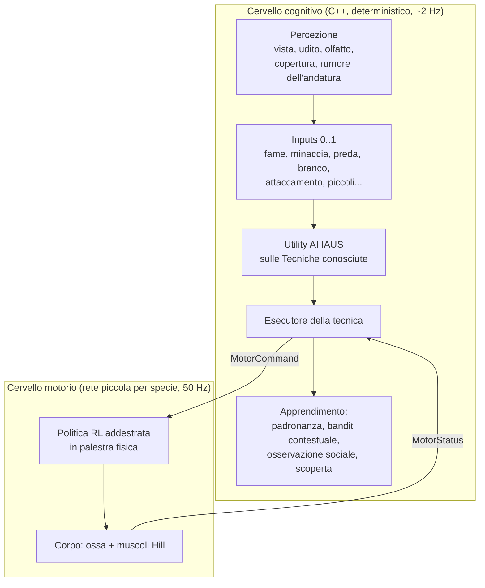

# Il cervello delle creature: architettura, legami, generazioni

> **📍 DOVE SIAMO**
> - ✅ **Cervello cognitivo** implementato in C++ nel core (`core/include/primeva/brain/`). È deterministico e guidato dai dati (`data/brain/techniques.json`), e lo stesso modello vale per creature selvatiche e addomesticate.
> - ✅ **Legami, attaccamento, nascite, generazioni**: ereditarietà genetica degli istinti e culturale delle tecniche, imprinting sul padrone.
> - ✅ **Corteccia motoria (esperimento)**: corpo muscolo-scheletrico procedurale e PPO in MuJoCo, sul terreno del nostro generatore.
> - ✅ Laboratorio `brain_lab` (7 esperimenti) e 18 test verdi.
> - ⏭️ **Prossimo passo**: allenare dentro il mondo voxel vero (Fase B), poi gli agenti "allenatori" (Fase C). Dettagli nella sezione 7.

---

## 1. Principio: due cervelli, una sola interfaccia

- **Cervello cognitivo**: decide *cosa* fare e *perché*. Impara nel corso della vita della creatura e trasmette ciò che sa.
- **Cervello motorio**: sa *come* muovere ossa e muscoli. Lo addestriamo offline con il rinforzo (RL) in una palestra fisica. In gioco gira solo vicino ai giocatori; lontano un modello cinematico esegue lo stesso `MotorCommand`.
- **L'interfaccia `MotorCommand`** (meta, andatura, azione, sguardo) è la stessa per creature selvatiche, addomesticate e cavalcate. Il cavaliere emette comandi dello stesso tipo.

Perché non una sola rete neurale enorme per creatura? Nel multiplayer non è deterministica, non si può spiegare al giocatore, costa troppo con migliaia di creature e non si può testare. L'RL serve dove funziona davvero: imparare a muovere un corpo. Per il resto usiamo apprendimento tabellare e sociale, che è spiegabile.

## 2. Selvatico e addomesticato: lo stesso cervello

Non esiste un "modulo addomesticamento". L'addomesticamento cambia solo **dati**:
1. un **proprietario** e un **legame** con lui;
2. l'**obbedienza per comando**, che cresce solo se il comando eseguito viene premiato;
3. un **canale di ricompensa** aggiuntivo (lode o rimprovero), pesato da legame e socialità;
4. la **figura d'attaccamento**, che può diventare il padrone.

Conseguenza voluta: un selvatico catturato porta con sé tutto ciò che ha imparato in natura, e un domestico rilasciato continua a usare ciò che ha imparato dal padrone.

## 3. Legami e attaccamento

Modello ispirato a Bowlby (attaccamento), Lorenz (imprinting) e Cavalli-Sforza & Feldman (trasmissione culturale).

| Tipo di legame | Come nasce | Come cresce | Come decade |
|---|---|---|---|
| **Genitore** (figlio→genitore) | alla nascita, 0,6 | cibo ricevuto (+0,05), vicinanza (+0,002), protezione | alla maturità, in base alla dispersione della specie |
| **Figlio** (genitore→figlio) | alla nascita, 0,6 | nutrire (+0,03) | come sopra |
| **Compagno** | accoppiamento (+0,2) | riproduzioni successive | senza contatto |
| **Branco** | nascita nel gruppo (10× il guadagno di specie) | cacce condivise riuscite | −decadimento/giorno senza contatto |
| **Padrone** | imprinting (0,85) o fiducia (0,4) | premi, cibo, vicinanza | rimproveri (−0,01) |

**Profilo di legame per struttura sociale**, derivato dal roster in `species.cpp`:

| Struttura | Cure | Allevamento | Guadagno di branco | Dispersione |
|---|---|---|---|---|
| branco | 0,9 | **comunitario** (tutti gli adulti nutrono e difendono i piccoli) | 0,03 | 0,1 |
| coppia | 0,8 | biparentale | 0,02 | 0,7 |
| mandria | 0,6 | madre | 0,008 | 0,3 |
| colonia | 0,5 | madre | 0,01 | 0,4 |
| solitario | 0,4 | madre fino alla dispersione | 0 | 1,0 |
| sciame | 0,1 | — | 0,002 | 1,0 |

- Il **tempo di maturazione** scala come M^0,25 (allometria dello sviluppo).
- La **covata** va da 1 a 5 uova: i piccoli ne depongono di più (strategia r), i giganti meno (strategia K).

**Imprinting alla schiusa.** La prima figura che si prende cura del piccolo diventa la sua *figura d'attaccamento*: normalmente la madre. Se il padrone è presente (madre addomesticata, o specie con `imprinting_egg` nel roster), lo diventa il padrone. Il piccolo poi:
- lo **segue** (`follow_attachment`, con più forza da giovane);
- lo **osserva** con attenzione moltiplicata (0,3 + 1,2 × legame, ×1,5 se è il genitore);
- impara **prima e meglio da lui**.

**Orfani.** Nei branchi un adulto adotta l'orfano: la nuova figura d'attaccamento diventa il legame adulto più forte del gruppo.

**Comportamenti parentali**, cioè tecniche istintive disponibili solo a chi ha piccoli che dipendono da lui:
- `provision_young`: i carnivori portano o rigurgitano cibo al piccolo più affamato;
- `guard_young`: carica il predatore vicino ai piccoli;
- **insegnamento con preda viva**: `capture_pin` vale 0,7 se i propri piccoli sono a meno di 40 m, perché diventa lezione (come le femmine di ghepardo, Caro 1994). Altrimenti è gioco, che annoia con la ripetizione.

## 4. Apprendimento: dove, come, da chi

| Meccanismo | Implementazione | Note |
|---|---|---|
| Valore per contesto | bandit contestuale tabellare, `q ← q + α(r − q)`, 24 contesti (taglia della preda × branco × addomesticato) | esplorazione UCB × curiosità |
| Padronanza (mastery) | `Δm = η(1−m)^1,4 · r⁺ · talento` | solo per le tecniche con difficoltà > 0 (bere non si "padroneggia") |
| Abilità di categoria | 23 categorie, crescita con rendimenti decrescenti | il talento della specie (affinità del roster) dà da 0,6× a 1,4× |
| Osservazione | esposizioni → familiarità → emulazione → **acquisizione** (servono ≥4 esposizioni per il tier 3, ≥8 per il tier 2, il tier 1 mai) | fedeltà 0,85^generazione |
| Scoperta | innovazione vincolata: `p = p₀ · curiosità · (0,5 + giocosità) · tier` in un contesto-innesco | nessun codice nuovo: solo tecniche della libreria |
| Dimenticanza | emivita di 30 giorni × padronanza; minimo al 35% del picco | riapprendimento rapido |
| Deriva di personalità | ±0,25 per i domestici, ±0,15 per i selvatici | vincere rende audaci, essere feriti rende cauti |
| **Ereditarietà genetica** | istinti innati = media dei genitori + mutazione (σ 0,03) | la selezione naturale agisce sugli istinti |
| **Ereditarietà culturale** | solo per osservazione, pesata dal legame | verticale, orizzontale, obliqua, dal padrone: tutte misurate |

**Decisione.** Le tecniche si scelgono con la Utility AI IAUS: prodotto di considerazioni con compensazione, modulazione d'istinto, valore Q, padronanza e comando. La selezione è morbida tra le prime tre, con temperatura *relativa* che cala sotto stress. C'è un'**isteresi del 25%**: una creatura cambia attività solo se l'alternativa è nettamente migliore. Senza isteresi, nei test le creature cambiavano idea ogni 0,5 s (3.224 episodi di "bere" in un giorno).

**"Perché l'ha fatto?"** `Ecosystem::explain()` restituisce gli input percepiti e la scomposizione dell'utilità di ogni tecnica. È lo strumento che ha diagnosticato tutti i bug di questa fase, e diventerà la UI di gioco.

## 5. Cervello motorio: corpi e palestra

- **`tools/gym/bodyplan.py`**: genera il corpo da un piano corporeo JSON.
  - I segmenti sono capsule con densità tarata sulla massa reale (sacchi aerei inclusi).
  - Ogni grado di libertà ha una **coppia antagonista di muscoli Hill**.
  - **F₀ = 0,3 MPa × PCSA**, con la massa muscolare presa dalla paleobiomeccanica (arti posteriori ≈ 28% della massa nei teropodi cursori).
  - Esempio: dromeosauride da 20,00 kg, 18 gradi di libertà, 36 muscoli, estensione dell'anca 103 N·m.
- **`tools/gym/env.py`**: compito "segui velocità e virata comandate".
  - Il terreno è quello di **Primeva**, esportato con `primeva_cli heightmap`; l'errore rispetto al raycast di MuJoCo è 0,000 m.
  - Ricompensa a priori di andatura periodica (Siekmann 2021: niente motion capture, che per animali estinti non esiste), costo metabolico, postura orizzontale del busto.
- **`tools/gym/ppo.py`**: PPO multiprocesso su CPU, curriculum di velocità, terreni misti (piano, dolce, medio).
- Due modalità a confronto: **muscoli Hill** contro **PD con limiti di coppia fisiologici**. La ricerca (`research/05`, `research/06`) indica il PD come opzione da runtime e i muscoli come opzione da addestramento.

## 6. Reward hacking trovato e corretto (lezione di metodo)

Due "imbrogli" emergenti scoperti in questa fase:
1. **Catture in loop.** I predatori selvatici catturavano ripetutamente la stessa preda già immobilizzata, fino a 2.289 catture al giorno, per incassare la ricompensa di gioco. Correzione: niente ricattura, novità decrescente, e valore della cattura legato all'insegnamento ai piccoli.
2. **Treppiede sulla coda.** La prima politica motoria si sedeva sulla coda usandola come terza gamba, col busto quasi verticale. Le metriche numeriche sembravano accettabili: *solo il filmato lo ha rivelato*. Correzione: coda a terra = caduta (le piste fossili non mostrano coda trascinata), busto entro ±37° dall'orizzontale, ricompensa di postura.

**Principio che ne deriva.** Ogni ricompensa va verificata con statistiche *e* con il filmato del comportamento. È esattamente il lavoro che affideremo agli agenti allenatori (sezione 7, Fase C).

## 7. Roadmap del cervello

| Fase | Contenuto | Note |
|---|---|---|
| **A. Fatto** | cervello cognitivo, legami, generazioni, imprinting, palestra motoria | questo documento |
| **B. Allenamento nel mondo vero** | l'ecosistema usa il terreno voxel reale (`WorldGenerator`), la **flora per bioma** come cibo e copertura (da `biomes.json`), acqua da laghi e fiumi della macro-mappa, notte e giorno, stagioni. Le politiche motorie muovono i corpi vicino ai punti osservati. **Generazioni di simulazione** con selezione, migliaia di giorni di gioco, tutto su CPU per la parte cognitiva | Fattibile qui. La parte motoria su larga scala richiede GPU (Isaac Lab / MuJoCo Playground) |
| **C. Agenti allenatori (Haiku, effort alto)** | un agente per specie o branco legge metriche, `explain`, filmati e curve di apprendimento. Propone modifiche a ricompense, curricula e parametri delle tecniche, le prova su più semi e su terreni tenuti da parte, e le promuove solo se migliorano senza rompere i test di plausibilità biologica | Come Eureka (NVIDIA 2023). Gli agenti **progettano l'addestramento**, non sono il cervello |
| **D. Il padrone come genitore** | curriculum finale di addomesticamento: imprinting dall'uovo, insegnamento con la modalità "Mostra", obbedienza che si costruisce col rinforzo | Il meccanismo esiste già (sezione 3): va tarato |

**Protocollo proposto per gli agenti allenatori (Fase C):**
- **Input**: `out/brain/*.csv`, dump di `explain`, filmstrip delle politiche motorie, log PPO.
- **Azioni ammesse**: modificare *dati* (pesi, curve, soglie in `techniques.json`, pesi di ricompensa dell'ambiente, curriculum) entro limiti dichiarati. Mai test né codice del core.
- **Valutazione**: almeno 3 semi, terreni o ecosistemi tenuti da parte, metriche obiettivo per specie (successo di caccia, sopravvivenza dei piccoli, persistenza culturale, legami, coerenza etologica) più la revisione del filmato.
- **Registro**: ogni modifica annotata con motivazione e risultati; si promuove solo con miglioramento significativo.
